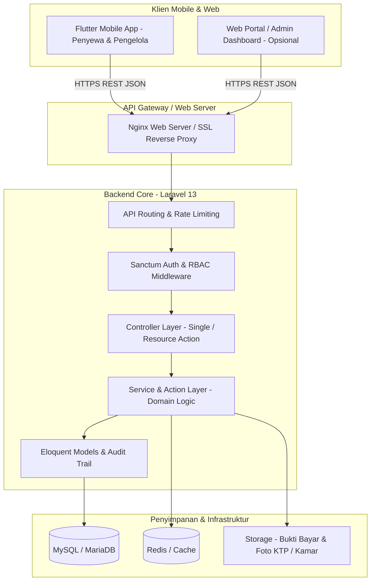

# Arsitektur Sistem - SIM Kos & Guesthouse

Dokumen ini menjelaskan arsitektur tingkat tinggi, prinsip desain, modul fungsional, dan standar teknis yang diterapkan pada proyek **SIM Kos & Guesthouse**.

---

## 1. Ringkasan Sistem

SIM Kos & Guesthouse adalah platform terintegrasi untuk pengelolaan operasional properti hunian sewa, baik berupa **Kos (sewa jangka panjang: bulanan/tahunan)** maupun **Guesthouse (sewa jangka pendek: harian/mingguan)** atau properti bertipe **Hybrid** (kombinasi keduanya).

Sistem dibangun dengan arsitektur **API-First & Client-Server Terpisah**:
- **Backend**: Laravel 13 REST API (PHP 8.4) melayani seluruh logika bisnis, validasi, orkestrasinya, otentikasi, dan pelaporan keuangan.
- **Mobile**: Flutter & Dart (Cross-platform Android & iOS) dengan State Management Riverpod dan GoRouter.
- **Database**: Relational Database Management System (MySQL 8.0 / MariaDB 10.11 LTS).
- **Security & Auth**: Laravel Sanctum berbasis bearer token dengan expiration, rate limiting, dan role-based access control (RBAC).



---

## 2. Prinsip Desain (Design Principles)

1. **Modular & Domain-Driven**:
   Modul bisnis dipisahkan berdasarkan domain fungsional:
   - `Auth & User Management`
   - `Property & Room Management`
   - `Rental & Booking (Kos vs Guesthouse)`
   - `Finance (Invoices, Payments, Expenses)`
   - `Utility Metering (Listrik & Air)`
   - `Maintenance & Incident Complaint`
   - `Reporting & Analytics`

2. **Clean Separation of Concerns**:
   - **Controller Layer**: Bertanggung jawab menerima request HTTP, validasi form request, memanggil service layer, dan mengembalikan response JSON standar.
   - **Service / Action Layer**: Menampung business logic terpusat agar reusable baik oleh controller, queue worker, maupun console command.
   - **Resource Layer (Laravel API Resources)**: Menjamin format data response konsisten dan menyembunyikan struktur internal tabel database.

3. **Standard Response Format**:
   Seluruh respon API mengikuti standar format JSON berikut:
   ```json
   {
     "success": true,
     "message": "Deskripsi pesan keberhasilan",
     "data": {},
     "meta": {
       "page": 1,
       "per_page": 15,
       "total": 100
     }
   }
   ```
   Format error:
   ```json
   {
     "success": false,
     "message": "Pesan error validasi atau eksepsi",
     "errors": {
       "field_name": ["Detail pesan validasi"]
     }
   }
   ```

4. **Security Hardening**:
   - Sanitasi input dan proteksi SQL Injection menggunakan Eloquent ORM & Prepared Statements.
   - Proteksi XSS dan CSRF pada channel yang relevan.
   - Rate limiting ketat pada endpoint autentikasi (`/api/v1/auth/login`, `/api/v1/auth/forgot-password`).
   - Penyimpanan password menggunakan hashing Argon2id / Bcrypt default Laravel.
   - Privasi data KTP penyewa disimpan dalam direktori storage privat yang hanya dapat diakses staf berwenang melalui signed URL.
   - Bukti transfer (`payment_proofs/`) disimpan pada disk lokal privat dan hanya dialirkan via endpoint aman terotentikasi (`/api/v1/payments/{id}/proof`) dengan otorisasi tenant pemilik atau staf properti.

5. **Abstraksi Pembayaran & Kesiapan Payment Gateway (Phase 2)**:
   - Arsitektur memisahkan secara tegas konsep:
     - `Invoice`: Kewajiban tagihan sewa / utilitas.
     - `Payment`: Upaya / record transaksi pembayaran (bisa bertahap / parsial).
     - `PaymentProviderInterface`: Kontrak penyedia pembayaran (`getProviderKey()`, `processPayment()`, `verifyPayment()`, `handleWebhook()`).
     - `ManualTransferProvider`: Implementasi tahap pertama untuk transfer bank dan e-wallet manual dengan upload slip mutasi.
     - `PaymentService`: Orkestrasi verifikasi finansial menggunakan `lockForUpdate()` database pessimistic locking, pencegahan overpayment, dan penolakan otomatis verifikasi diri sendiri (`self-verification forbidden`).
   - Kesiapan Gateway Masa Depan: Provider baru (Midtrans, Xendit) dapat didaftarkan ke container tanpa merombak logika booking dan invoice.

6. **Web Dashboard Operasional (Laravel 13 + Bootstrap 5)**:
   - Antarmuka berbasis web responsif untuk Owner, Manajer, Kasir, dan Resepsionis.
   - Menggunakan autentikasi berbasis sesi terpisah dari token Sanctum mobile.
   - Dilindungi proteksi CSRF, escaping Blade, pagination server-side, dan permission check ketat pada setiap controller.

---

## 3. Struktur Modul Backend (Laravel 13)

```
backend/
├── app/
│   ├── Enums/                 # RoleEnum, BookingStatusEnum, InvoiceStatusEnum, RoomStatusEnum
│   ├── Http/
│   │   ├── Controllers/
│   │   │   └── Api/V1/        # Auth, Property, Room, Booking, Invoice, Complaint, etc.
│   │   ├── Middleware/        # EnsureRole, EnsurePropertyAccess, ForceJsonResponse
│   │   ├── Requests/          # Form Request Validators
│   │   └── Resources/         # Eloquent API Resources
│   ├── Models/                # User, Property, Room, RoomType, Booking, Invoice, Payment, dll.
│   ├── Services/              # BookingService, InvoiceService, PaymentService, MeteringService
│   └── Notifications/         # WhatsApp/Push Notification triggers
├── config/
├── database/
│   ├── migrations/            # Skema tabel database
│   └── seeders/               # Data awal (Role, Admin, Property Demo)
├── routes/
│   ├── api.php                # Endpoint REST API v1
│   └── console.php            # Scheduled Jobs (Auto invoice bulanan, check-out reminder)
└── tests/
    ├── Feature/               # API Integration & Feature Tests
    └── Unit/                  # Unit tests untuk kalkulasi tarif & denda
```

---

## 4. Struktur Arsitektur Mobile (Flutter)

Aplikasi Flutter menerapkan pola **Feature-First Layered Architecture**:

```
mobile/
├── lib/
│   ├── core/
│   │   ├── constants/         # AppColors, AppStrings, AppConstants, ApiEndpoints
│   │   ├── network/           # DioClient, TokenInterceptor, ApiExceptionHandler
│   │   ├── storage/           # LocalSecureStorage / SharedPrefs (Token, Profile)
│   │   ├── theme/             # Light & Dark Theme, Typography Outfit/Inter
│   │   └── utils/             # CurrencyFormatter (IDR), DateFormatter (WIB)
│   ├── features/
│   │   ├── auth/              # Login, Register, Forgot Password, Profile
│   │   ├── properties/        # Daftar Kos/Guesthouse, Detail Cabang
│   │   ├── rooms/             # Tipe Kamar, Ketersediaan, Detail Fasilitas
│   │   ├── bookings/          # Alur Booking Harian & Pengajuan Kos Bulanan
│   │   ├── invoices/          # Riwayat Tagihan, Rincian Sewa & Listrik, Upload Bukti
│   │   ├── complaints/        # Tiket Komplain & Kerusakan dengan Foto
│   │   └── reports/           # Ringkasan Okupansi & Keuangan (Khusus Owner/Staf)
│   ├── routing/
│   │   └── app_router.dart    # GoRouter konfigurasi & route guard (Auth/Role)
│   └── main.dart              # Inisialisasi Riverpod ProviderScope & App Entry
└── test/                      # Widget & Unit Testing
```

---

## 5. Strategi Deployment & Lingkungan (Environments)

1. **Development (Lokal)**:
   - PHP 8.4 (Laravel Herd / Docker)
   - SQLite untuk pengujian cepat atau MySQL 8.0 via Docker Compose
   - Flutter Emulator / Real Device terhubung ke `http://10.0.2.2:8000` (Android) atau `http://localhost:8000` (iOS).

2. **Staging / Production**:
   - Nginx Reverse Proxy dengan TLS/SSL (Let's Encrypt).
   - MySQL 8.0 / MariaDB 10.11 dengan backup harian terjadwal.
   - Redis untuk Cache & Horizon Queue Worker (notifikasi email/WA dan kalkulasi invoice).
   - CI/CD via GitHub Actions untuk linting, automated testing, dan validasi build Flutter APK.

---

## 6. Arsitektur Modul Inspeksi & Checklist Kamar (Tahap 3)

### A. Domain Service: `InspectionService`
Berada pada `app/Services/Inspection/InspectionService.php`, merangkum seluruh aturan bisnis inspeksi:
1. **Checklist Provisioning**: Otomatis menduplikasi master aset fisik (`room_assets`) dari kamar atau menggunakan template standar 8 item checklist (`DEFAULT_CHECKLIST_ITEMS`).
2. **State Transition Engine**:
   - `scheduled` -> `in_progress` (oleh Staf/Inspector saat mulai pemeriksaan).
   - `in_progress` -> `completed` (setelah checklist diperiksa & foto diunggah; menetapkan batas waktu keputusan penyewa `tenant_due_at`).
   - `completed` -> `approved_by_tenant` (Penyewa menyetujui kondisi tanpa sanggahan).
   - `completed` -> `objected_by_tenant` (Penyewa mengajukan keberatan dengan catatan spesifik).
3. **Baseline Comparison Engine**:
   Membandingkan inspeksi check-out dengan inspeksi baseline (check-in awal):
   - Membandingkan gradasi kondisi: `good` (4) > `fair` (3) > `poor` (2) > `damaged` (1) > `missing` (0).
   - Mendeteksi penurunan kondisi (`is_degraded = true`) atau butuh perbaikan (`repair_required = true`).
   - Menghitung total estimasi biaya kerusakan (`total_damage_cost`) untuk pemotongan deposit sewa.

### B. Keamanan Media & Private Disk Storage
- Seluruh foto bukti inspeksi disimpan di private storage (`storage/app/private/inspections/{id}/`).
- Tidak ada foto yang terekspos langsung ke URL publik.
- Akses file foto disalurkan melalui controller streaming terotentikasi Sanctum/Session dengan pemeriksaan hak akses properti dan penyewa (`canAccessInspection`).

### C. Audit Trail Terintegrasi (`inspection_logs`)
Setiap aksi signifikan (pembuatan jadwal, mulai inspeksi, update butir checklist, unggah foto, penyelesaian inspeksi, persetujuan penyewa, serta keberatan) dicatat secara permanen dengan `user_id`, aksi, deskripsi, dan metadata kontekstual.
