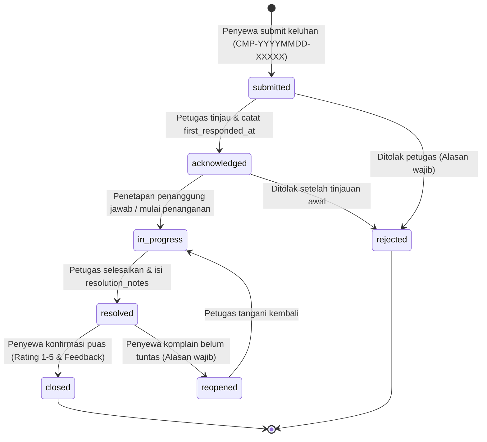

# Tenant Complaints Workflow - SIM Kos & Guesthouse

Dokumen ini menjelaskan alur penanganan keluhan penyewa, penomoran tiket unik, isolasi catatan internal, penautan ke tiket maintenance, serta siklus konfirmasi dan pembukaan kembali keluhan.

---

## 1. Alur & State Machine Keluhan (Tenant Complaints)

### Penjelasan Transisi Status
1. **`submitted`**:
   - Penyewa mengisi judul, kategori keluhan, tingkat urgensi, dan deskripsi permasalahan serta foto bukti pendukung.
   - Sistem membangkitkan nomor tiket unik dengan format `CMP-YYYYMMDD-XXXXX`.
   - Notifikasi dikirimkan ke tim pengelola properti terkait.
2. **`acknowledged`**:
   - Petugas pengelola menekan tombol "Acknowledge" untuk memberi sinyal kepada penyewa bahwa tiket telah dibaca dan masuk antrean penanganan.
   - Waktu respons pertama (`first_responded_at`) direkam otomatis guna pengukuran metrik layanan (SLA respons).
3. **`in_progress`**:
   - Penetapan penanggung jawab teknis (`assigned_to`).
   - Petugas dan penyewa dapat berbalas pesan secara berurutan dalam thread tanggapan keluhan.
4. **`resolved`**:
   - Petugas menyelesaikan kendala yang dilaporkan dan mengisi catatan solusi (`resolution_notes`).
   - Tiket belum ditutup permanen; penyewa diberikan kesempatan untuk memverifikasi kondisi lapangan.
5. **`closed`**:
   - Penyewa menekan tombol "Konfirmasi Selesai", memberikan rating kepuasan (1–5 bintang) dan ulasan singkat.
   - Tiket ditutup permanen dengan perekaman `closed_at` dan `closed_by`.
6. **`reopened`**:
   - Jika perbaikan belum tuntas atau kendala berulang, penyewa berhak menekan tombol "Buka Kembali" dengan menyertakan alasan wajib (`reopen_reason`).
   - Status kembali menjadi aktif (`reopened`), dan notifikasi prioritas dikirimkan ke petugas yang menangani.
7. **`rejected`**:
   - Jika keluhan tidak berdasar atau di luar kewenangan operasional kos, petugas dapat menolak dengan mencantumkan alasan penolakan resmi (`rejection_reason`).

---

## 2. Percakapan Berulir & Catatan Koordinasi Internal

Setiap tiket keluhan mendukung percakapan multi-pesan (`complaint_comments`) dengan mekanisme privasi:
1. **Tanggapan Publik (`is_internal = false`)**:
   - Terlihat oleh penyewa pelapor dan staf pengelola. Digunakan untuk menyapa, meminta konfirmasi jadwal kunjungan, atau mengabarkan perkembangan penanganan.
2. **Catatan Internal Petugas (`is_internal = true`)**:
   - Digunakan oleh manajer, kasir, atau staf untuk koordinasi internal (misal: "Menunggu suku cadang dari supplier", "Penyewa ini sebelumnya pernah komplain serupa").
   - **Disaring ketat di backend**: Query API `/api/v1/complaints/{id}` untuk role tenant secara otomatis mengecualikan seluruh komentar yang memiliki `is_internal = true`.

---

## 3. Penautan Idempoten ke Tiket Perbaikan Fisik

Keluhan yang memerlukan tindakan fisik (seperti AC rusak, pipa bocor) dapat ditautkan ke tiket perbaikan melalui aksi:
`POST /api/v1/complaints/{id}/link-maintenance`

### Aturan Idempotensi:
- Jika keluhan belum memiliki tiket perbaikan, sistem membuat `MaintenanceRequest` baru yang terisi otomatis dengan kategori, kamar, dan deskripsi keluhan, lalu menyimpan referensinya di `complaints.maintenance_request_id`.
- Jika keluhan sudah terhubung (`complaint->maintenance_request_id != null`), pemanggilan ulang endpoint ini **TIDAK AKAN** membuat tiket perbaikan duplikat, melainkan mengembalikan tiket maintenance yang sudah ada.

---

## 4. Perlindungan Finansial: Keluhan Tagihan

Penyewa dapat memilih kategori keluhan `billing` apabila mendapati kekeliruan perhitungan biaya sewa atau listrik.
- **Aturan Keamanan**: Keluhan tagihan **TIDAK BOLEH** secara otomatis mengubah nilai invoice, menghapus denda, atau mengubah status pembayaran.
- Seluruh koreksi nominal harus dilakukan melalui alur resmi penagihan (revisi invoice / diskon yang diaudit) oleh manajer yang berwenang.
