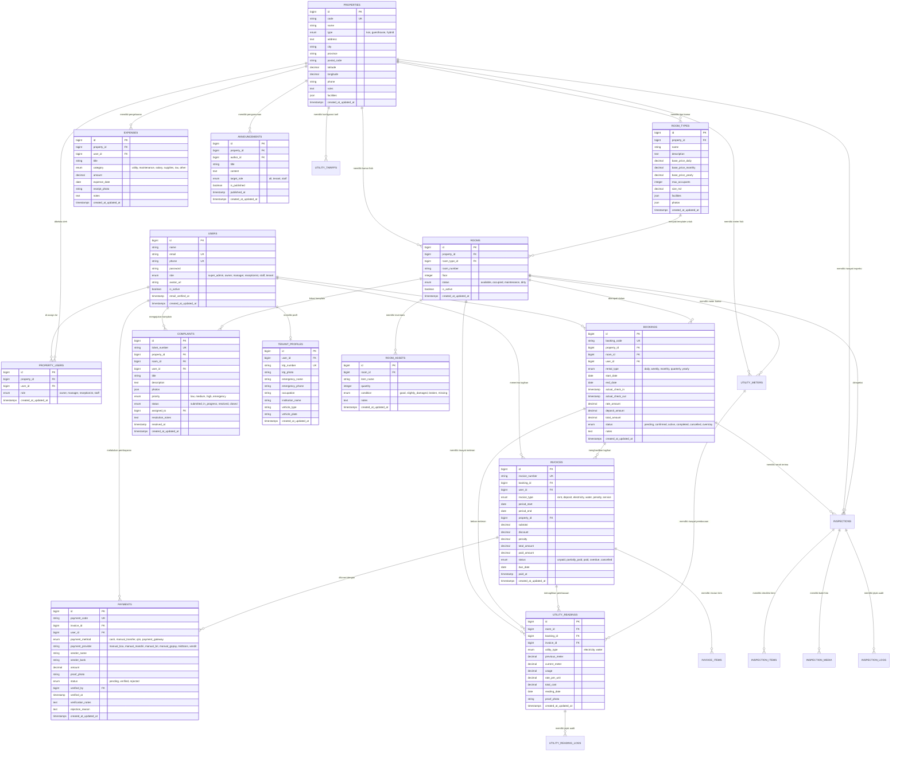

# Desain ERD & Skema Database - SIM Kos & Guesthouse

Dokumen ini berisi rancangan relasi basis data (Entity Relationship Diagram), kamus data lengkap, indexing, dan aturan integritas relasional untuk **SIM Kos & Guesthouse**.

---

## 1. Diagram Relasi Entitas (Mermaid ERD)

---

## 2. Kamus Data & Indexing

### Tabel: `users`
- **Fungsi**: Menyimpan akun pengguna semua peran.
- **Index**:
  - `PRIMARY KEY (id)`
  - `UNIQUE (email)`
  - `UNIQUE (phone)`
  - `INDEX (role, is_active)`

### Tabel: `properties`
- **Fungsi**: Menyimpan unit properti (Kos Putri / Kos Putra / Guesthouse).
- **Index**:
  - `PRIMARY KEY (id)`
  - `UNIQUE (code)`
  - `INDEX (city, type)`

### Tabel: `rooms`
- **Fungsi**: Menyimpan kamar fisik spesifik pada properti.
- **Index**:
  - `PRIMARY KEY (id)`
  - `UNIQUE (property_id, room_number)`
  - `INDEX (status, is_active)`
  - `FOREIGN KEY (property_id) REFERENCES properties(id) ON DELETE CASCADE`
  - `FOREIGN KEY (room_type_id) REFERENCES room_types(id) ON DELETE RESTRICT`

### Tabel: `bookings`
- **Fungsi**: Transaksi penyewaan jangka panjang (Kos) maupun reservasi jangka pendek (Guesthouse).
- **Index**:
  - `PRIMARY KEY (id)`
  - `UNIQUE (booking_code)`
  - `INDEX (room_id, start_date, end_date, status)`
  - `INDEX (user_id, status)`
  - `FOREIGN KEY (property_id) REFERENCES properties(id)`
  - `FOREIGN KEY (room_id) REFERENCES rooms(id)`
  - `FOREIGN KEY (user_id) REFERENCES users(id)`

### Tabel: `invoices`
- **Fungsi**: Catatan kewajiban bayar penyewa (biaya sewa, deposit, listrik, denda overstay).
- **Index**:
  - `PRIMARY KEY (id)`
  - `UNIQUE (invoice_number)`
  - `INDEX (booking_id, status, due_date)`
  - `INDEX (user_id, status)`
  - `FOREIGN KEY (booking_id) REFERENCES bookings(id) ON DELETE CASCADE`
  - `FOREIGN KEY (user_id) REFERENCES users(id)`

### Tabel: `payments`
- **Fungsi**: Rekam jejak transaksi pembayaran masuk.
- **Index**:
  - `PRIMARY KEY (id)`
  - `UNIQUE (payment_code)`
  - `INDEX (invoice_id, status)`
  - `FOREIGN KEY (invoice_id) REFERENCES invoices(id) ON DELETE CASCADE`
  - `FOREIGN KEY (user_id) REFERENCES users(id)`
  - `FOREIGN KEY (verified_by) REFERENCES users(id)`

### Tabel: `room_assets`
- **Fungsi**: Master inventaris dan aset bawaan fisik di dalam kamar (e.g. AC, kasur, lemari, kunci, water heater).
- **Index**:
  - `PRIMARY KEY (id)`
  - `INDEX (room_id, asset_name)`
  - `FOREIGN KEY (room_id) REFERENCES rooms(id) ON DELETE CASCADE`

### Tabel: `inspections`
- **Fungsi**: Entitas utama inspeksi berkala, serah terima check-in, dan pemeriksaan check-out keluar kamar.
- **Index**:
  - `PRIMARY KEY (id)`
  - `UNIQUE (inspection_code)`
  - `INDEX (property_id, status, scheduled_date)`
  - `INDEX (room_id, type)`
  - `INDEX (booking_id)`
  - `INDEX (inspector_id)`
  - `INDEX (tenant_id)`
  - `FOREIGN KEY (property_id) REFERENCES properties(id)`
  - `FOREIGN KEY (room_id) REFERENCES rooms(id)`
  - `FOREIGN KEY (booking_id) REFERENCES bookings(id) ON DELETE SET NULL`
  - `FOREIGN KEY (inspector_id) REFERENCES users(id)`
  - `FOREIGN KEY (tenant_id) REFERENCES users(id)`
  - `FOREIGN KEY (baseline_inspection_id) REFERENCES inspections(id) ON DELETE SET NULL`

### Tabel: `inspection_items`
- **Fungsi**: Rincian butir checklist fasilitas, kondisi fisik saat inspeksi, catatan khusus, status perbaikan, dan estimasi biaya perbaikan.
- **Index**:
  - `PRIMARY KEY (id)`
  - `INDEX (inspection_id, condition)`
  - `INDEX (room_asset_id)`
  - `FOREIGN KEY (inspection_id) REFERENCES inspections(id) ON DELETE CASCADE`
  - `FOREIGN KEY (room_asset_id) REFERENCES room_assets(id) ON DELETE SET NULL`

### Tabel: `inspection_media`
- **Fungsi**: Rekam foto bukti visual saat inspeksi dilakukan (disimpan privat, dilayani via streaming controller terotentikasi).
- **Index**:
  - `PRIMARY KEY (id)`
  - `INDEX (inspection_id)`
  - `INDEX (inspection_item_id)`
  - `FOREIGN KEY (inspection_id) REFERENCES inspections(id) ON DELETE CASCADE`
  - `FOREIGN KEY (inspection_item_id) REFERENCES inspection_items(id) ON DELETE SET NULL`

### Tabel: `inspection_logs`
- **Fungsi**: Audit trail permanen yang mencatat setiap aksi inspeksi (dibuat, dimulai, item diupdate, foto diupload, diselesaikan, disetujui penyewa, atau diajukan keberatan).
- **Index**:
  - `PRIMARY KEY (id)`
  - `INDEX (inspection_id, action)`
  - `INDEX (user_id)`
  - `FOREIGN KEY (inspection_id) REFERENCES inspections(id) ON DELETE CASCADE`
  - `FOREIGN KEY (user_id) REFERENCES users(id)`

### Tabel: `utility_meters`
- **Fungsi**: Master data fisik meter utilitas listrik (kWh) dan air (m³) per kamar individual atau komunal/bersama.
- **Index**:
  - `PRIMARY KEY (id)`
  - `UNIQUE (meter_number)`
  - `INDEX (property_id, utility_type, is_active)`
  - `INDEX (room_id, utility_type)`
  - `FOREIGN KEY (property_id) REFERENCES properties(id) ON DELETE CASCADE`
  - `FOREIGN KEY (room_id) REFERENCES rooms(id) ON DELETE SET NULL`

### Tabel: `utility_tariffs`
- **Fungsi**: Riwayat dan konfigurasi tarif utilitas per properti dan jenis utilitas dengan tanggal masa berlaku efektif.
- **Index**:
  - `PRIMARY KEY (id)`
  - `INDEX (property_id, utility_type, is_active)`
  - `INDEX (effective_from, effective_to)`
  - `FOREIGN KEY (property_id) REFERENCES properties(id) ON DELETE CASCADE`
  - `FOREIGN KEY (created_by) REFERENCES users(id) ON DELETE SET NULL`
  - `FOREIGN KEY (updated_by) REFERENCES users(id) ON DELETE SET NULL`

### Tabel: `utility_readings` (Diperluas)
- **Fungsi**: Pencatatan nilai meter berkala, perhitungan pemakaian ($current - previous$), snapshot tarif, foto bukti privat, dan status review/billing.
- **Index**:
  - `PRIMARY KEY (id)`
  - `INDEX (meter_id)`
  - `INDEX (property_id)`
  - `INDEX (room_id)`
  - `INDEX (status)`
  - `INDEX (is_billed)`
  - `FOREIGN KEY (meter_id) REFERENCES utility_meters(id) ON DELETE SET NULL`
  - `FOREIGN KEY (property_id) REFERENCES properties(id) ON DELETE SET NULL`
  - `FOREIGN KEY (room_id) REFERENCES rooms(id) ON DELETE CASCADE`
  - `FOREIGN KEY (booking_id) REFERENCES bookings(id) ON DELETE SET NULL`
  - `FOREIGN KEY (invoice_id) REFERENCES invoices(id) ON DELETE SET NULL`
  - `FOREIGN KEY (recorded_by) REFERENCES users(id) ON DELETE SET NULL`
  - `FOREIGN KEY (reviewed_by) REFERENCES users(id) ON DELETE SET NULL`

### Tabel: `utility_reading_logs`
- **Fungsi**: Jejak audit mutlak untuk setiap tindakan pencatatan, persetujuan, penolakan, koreksi, dan penagihan ke invoice.
- **Index**:
  - `PRIMARY KEY (id)`
  - `INDEX (utility_reading_id, created_at)`
  - `FOREIGN KEY (utility_reading_id) REFERENCES utility_readings(id) ON DELETE CASCADE`
  - `FOREIGN KEY (user_id) REFERENCES users(id) ON DELETE SET NULL`

### Tabel: `invoice_items`
- **Fungsi**: Rincian butir tagihan (line items breakdown) pada invoice existing untuk sewa, listrik, air, denda, dan layanan dengan snapshot tarif, volume, dan metadata pembacaan.
- **Index**:
  - `PRIMARY KEY (id)`
  - `INDEX (invoice_id, item_type)`
  - `FOREIGN KEY (invoice_id) REFERENCES invoices(id) ON DELETE CASCADE`

### Tabel: `maintenance_requests` (Phase 5)
- **Fungsi**: Pengelolaan tiket pekerjaan perbaikan fasilitas, kerusakan kamar, dan area umum dengan siklus SLA, penugasan teknisi, diagnosis, rincian biaya, dan verifikasi supervisor.
- **Index & Foreign Keys**:
  - `PRIMARY KEY (id)`
  - `UNIQUE (ticket_number)`
  - `INDEX (property_id, status)`
  - `INDEX (room_id, status)`
  - `INDEX (reporter_id)`
  - `INDEX (assigned_to)`
  - `INDEX (is_overdue)`
  - `INDEX (sla_due_at)`
  - `FOREIGN KEY (property_id) REFERENCES properties(id) ON DELETE CASCADE`
  - `FOREIGN KEY (room_id) REFERENCES rooms(id) ON DELETE SET NULL`
  - `FOREIGN KEY (room_asset_id) REFERENCES room_assets(id) ON DELETE SET NULL`
  - `FOREIGN KEY (reporter_id) REFERENCES users(id) ON DELETE CASCADE`
  - `FOREIGN KEY (assigned_to) REFERENCES users(id) ON DELETE SET NULL`
  - `FOREIGN KEY (assigned_by) REFERENCES users(id) ON DELETE SET NULL`
  - `FOREIGN KEY (verified_by) REFERENCES users(id) ON DELETE SET NULL`

### Tabel: `maintenance_logs` (Phase 5)
- **Fungsi**: Audit trail permanen terhadap setiap perubahan status, triase prioritas, penugasan, pengerjaan, dan verifikasi tiket maintenance.
- **Index & Foreign Keys**:
  - `PRIMARY KEY (id)`
  - `INDEX (maintenance_request_id, created_at)`
  - `FOREIGN KEY (maintenance_request_id) REFERENCES maintenance_requests(id) ON DELETE CASCADE`
  - `FOREIGN KEY (user_id) REFERENCES users(id) ON DELETE SET NULL`

### Tabel: `complaints` (Diperluas Phase 5)
- **Fungsi**: Penanganan keluhan penyewa ber-tiket unik (`CMP-YYYYMMDD-XXXXX`) terkait kamar, fasilitas, layanan, tagihan, atau lingkungan, dengan alur triase, penanggung jawab, waktu respons pertama, penyelesaian, konfirmasi penyewa (bintang 1-5), dan pembukaan kembali (`reopened`).
- **Index & Foreign Keys**:
  - `PRIMARY KEY (id)`
  - `UNIQUE (ticket_number)`
  - `INDEX (property_id, status)`
  - `INDEX (user_id)`
  - `INDEX (assigned_to)`
  - `FOREIGN KEY (property_id) REFERENCES properties(id) ON DELETE CASCADE`
  - `FOREIGN KEY (room_id) REFERENCES rooms(id) ON DELETE SET NULL`
  - `FOREIGN KEY (user_id) REFERENCES users(id) ON DELETE CASCADE`
  - `FOREIGN KEY (assigned_to) REFERENCES users(id) ON DELETE SET NULL`
  - `FOREIGN KEY (acknowledged_by) REFERENCES users(id) ON DELETE SET NULL`
  - `FOREIGN KEY (closed_by) REFERENCES users(id) ON DELETE SET NULL`
  - `FOREIGN KEY (maintenance_request_id) REFERENCES maintenance_requests(id) ON DELETE SET NULL`

### Tabel: `complaint_comments` (Phase 5)
- **Fungsi**: Thread percakapan dan tanggapan beruntun antara staf dan penyewa, mendukung penanda catatan internal (`is_internal = true`) yang disaring ketat dari pandangan penyewa.
- **Index & Foreign Keys**:
  - `PRIMARY KEY (id)`
  - `INDEX (complaint_id, created_at)`
  - `INDEX (is_internal)`
  - `FOREIGN KEY (complaint_id) REFERENCES complaints(id) ON DELETE CASCADE`
  - `FOREIGN KEY (user_id) REFERENCES users(id) ON DELETE CASCADE`

### Tabel: `complaint_logs` (Phase 5)
- **Fungsi**: Riwayat jejak audit siklus hidup keluhan (submitted, acknowledged, assigned, resolved, closed, reopened, rejected).
- **Index & Foreign Keys**:
  - `PRIMARY KEY (id)`
  - `INDEX (complaint_id, created_at)`
  - `FOREIGN KEY (complaint_id) REFERENCES complaints(id) ON DELETE CASCADE`
  - `FOREIGN KEY (user_id) REFERENCES users(id) ON DELETE SET NULL`

### Tabel: `housekeeping_tasks` (Phase 5)
- **Fungsi**: Penjadwalan tugas kebersihan kamar rutin, turnover tamu baru, deep cleaning, atau area bersama dengan checklist terkonfigurasi, bukti foto sebelum/sesudah, dan laporan temuan barang rusak/hilang.
- **Index & Foreign Keys**:
  - `PRIMARY KEY (id)`
  - `UNIQUE (task_number)`
  - `INDEX (property_id, scheduled_date)`
  - `INDEX (room_id, scheduled_date, status)`
  - `INDEX (assigned_to, status)`
  - `FOREIGN KEY (property_id) REFERENCES properties(id) ON DELETE CASCADE`
  - `FOREIGN KEY (room_id) REFERENCES rooms(id) ON DELETE SET NULL`
  - `FOREIGN KEY (assigned_to) REFERENCES users(id) ON DELETE SET NULL`
  - `FOREIGN KEY (assigned_by) REFERENCES users(id) ON DELETE SET NULL`
  - `FOREIGN KEY (verified_by) REFERENCES users(id) ON DELETE SET NULL`

### Tabel: `housekeeping_logs` (Phase 5)
- **Fungsi**: Jejak aktivitas penugasan, pengerjaan checklist, penyerahan verifikasi, dan penyelesaian tugas kebersihan.
- **Index & Foreign Keys**:
  - `PRIMARY KEY (id)`
  - `INDEX (housekeeping_task_id, created_at)`
  - `FOREIGN KEY (housekeeping_task_id) REFERENCES housekeeping_tasks(id) ON DELETE CASCADE`
  - `FOREIGN KEY (user_id) REFERENCES users(id) ON DELETE SET NULL`

### Tabel: `internal_notifications` (Phase 5)
- **Fungsi**: Fondasi notifikasi in-app internal untuk mengingatkan tiket baru, penugasan, tiket terlambat (overdue), dan permintaan verifikasi.
- **Index & Foreign Keys**:
  - `PRIMARY KEY (id)`
  - `INDEX (user_id, is_read)`
  - `INDEX (created_at)`
  - `FOREIGN KEY (user_id) REFERENCES users(id) ON DELETE CASCADE`
  - `FOREIGN KEY (property_id) REFERENCES properties(id) ON DELETE SET NULL`

---

## 3. Aturan Integritas, Anti-Double Booking & Batasan Bisnis Phase 5

1. **Pencegahan Overlapping Booking**:
   Sebelum status booking diubah menjadi `confirmed` atau `active`, sistem mengecek apakah ada booking lain pada `room_id` yang sama dengan rentang waktu beririsan:
   $$\text{Existing.start\_date} < \text{New.end\_date} \quad \text{AND} \quad \text{Existing.end\_date} > \text{New.start\_date}$$
   dengan status `IN ('confirmed', 'active')`.
2. **Kunci Kamar Saat Maintenance & Decoupling Housekeeping**:
   Kamar berstatus `maintenance` atau `dirty` tidak dapat dipilih untuk booking instan sebelum statusnya dikembalikan ke `available` oleh pengelola. Pengerjaan housekeeping atau verifikasi kebersihan **TIDAK PERNAH** secara otomatis mengubah status kamar menjadi vacant atau memanipulasi jadwal booking aktif tanpa workflow resmi rental lifecycle.
3. **Penyimpanan Nilai Uang & Presisi Utilitas & Biaya Maintenance**:
   Seluruh nilai uang sewa, tagihan, tarif, serta biaya tenaga kerja (`labor_cost`) dan biaya bahan (`material_cost`) pada tiket perbaikan menggunakan tipe data `DECIMAL(14, 2)` untuk menjamin integritas akuntansi.
4. **Idempotensi & Pencegahan Tagihan Ganda (Anti-Double Billing)**:
   Setiap pembacaan meter yang disetujui hanya dapat diterbitkan menjadi tagihan tepat satu kali (`is_billed = true` dan `invoice_id` terkunci). Operasi penagihan utilitas dilindungi oleh transaksi database dengan row-level lock (`lockForUpdate`). Upaya kedua otomatis ditolak dengan `422 Unprocessable Content`.
5. **Baseline Pembacaan Pertama & Non-Retroaktivitas Tarif**:
   Pembacaan pertama untuk kamar/meter baru wajib menggunakan `meter.initial_reading` sebagai baseline pembacaan sebelumnya agar penyewa baru tidak menanggung akumulasi meteran historis. Perubahan tarif baru berlaku prospektif dan tidak boleh mengubah angka tagihan atau pembacaan masa lalu secara otomatis.
6. **Pencegahan Tugas Kebersihan Aktif Duplikat (Anti-Duplicate Housekeeping)**:
   Sistem secara otomatis menolak pembuatan tugas kebersihan aktif (`scheduled`, `assigned`, `in_progress`, `pending_verification`) untuk kamar (`room_id`) yang sama pada tanggal jadwal (`scheduled_date`) yang sama dengan status `422 Unprocessable Content`, kecuali jika pengelola secara eksplisit menyertakan flag `allow_duplicate`.
7. **Idempotensi Penautan Keluhan ke Tiket Perbaikan (Complaint-Maintenance Link)**:
   Penautan keluhan penyewa ke tiket perbaikan bersifat idempoten: jika `complaint->maintenance_request_id` sudah ada, pemanggilan endpoint link tidak akan membuat tiket ganda melainkan mengembalikan tiket maintenance yang sudah terhubung.
8. **Isolasi Keluhan Finansial dari Modifikasi Invoice**:
   Keluhan yang berkategori tagihan (`billing`) tidak pernah memodifikasi invoice atau pembayaran secara otomatis. Seluruh penyesuaian nominal harus melalui alur koreksi finansial yang sah.

---

## 4. Skema Database Phase 6 (Financial Management & Operational Expenses)

### Tabel: `expense_categories`
- **Fungsi**: Master kategori pengeluaran operasional kos/guesthouse.
- **Kolom Utama**:
  - `id` (BIGINT, PK, Auto Increment)
  - `name` (VARCHAR 100, NOT NULL)
  - `code` (VARCHAR 50, UNIQUE, NOT NULL) - e.g. `rent_income`, `electricity_water`, `internet`, `maintenance`, `housekeeping`, `salaries_labor`, `supplies`, `tax_admin`, `other`
  - `type` (ENUM: `expense`, `income`, DEFAULT: `expense`)
  - `description` (TEXT, NULLABLE)
  - `is_active` (BOOLEAN, DEFAULT: true)
  - `created_at`, `updated_at` (TIMESTAMP)

### Tabel: `expenses` (Diperbarui pada Phase 6)
- **Fungsi**: Transaksi pengeluaran operasional dengan siklus approval dan pembayaran terpisah.
- **Kolom Utama**:
  - `id` (BIGINT, PK, Auto Increment)
  - `transaction_number` (VARCHAR 50, UNIQUE, NOT NULL) - Format: `EXP-YYYYMM-XXXX`
  - `property_id` (BIGINT, FK -> `properties.id`, CASCADE)
  - `expense_category_id` (BIGINT, FK -> `expense_categories.id`, RESTRICT)
  - `user_id` (BIGINT, FK -> `users.id`, pengaju draf/pembuat)
  - `expense_date` (DATE, NOT NULL)
  - `title` (VARCHAR 255, NOT NULL)
  - `description` (TEXT, NULLABLE)
  - `vendor` (VARCHAR 255, NULLABLE)
  - `amount` (DECIMAL 14, 2, NOT NULL)
  - `paid_amount` (DECIMAL 14, 2, DEFAULT: 0.00)
  - `payment_method` (VARCHAR 50, DEFAULT: `cash`)
  - `receipt_path` (VARCHAR 255, NULLABLE, private disk storage)
  - `approval_status` (ENUM: `draft`, `submitted`, `approved`, `rejected`, DEFAULT: `draft`)
  - `payment_status` (ENUM: `unpaid`, `partially_paid`, `paid`, DEFAULT: `unpaid`)
  - `submitted_at` (TIMESTAMP, NULLABLE)
  - `approved_by` (BIGINT, FK -> `users.id`, SET NULL)
  - `approved_at` (TIMESTAMP, NULLABLE)
  - `rejection_reason` (TEXT, NULLABLE)
  - `paid_at` (TIMESTAMP, NULLABLE)
  - `created_at`, `updated_at`, `deleted_at` (TIMESTAMP)

### Tabel: `expense_payments`
- **Fungsi**: Pencatatan riwayat pembayaran/pencairan dana pengeluaran (mendukung termin/parsial dan lunas).
- **Kolom Utama**:
  - `id` (BIGINT, PK, Auto Increment)
  - `expense_id` (BIGINT, FK -> `expenses.id`, CASCADE)
  - `paid_by` (BIGINT, FK -> `users.id`, RESTRICT)
  - `amount` (DECIMAL 14, 2, NOT NULL)
  - `payment_date` (DATE, NOT NULL)
  - `payment_method` (VARCHAR 50, NOT NULL)
  - `receipt_path` (VARCHAR 255, NULLABLE)
  - `notes` (TEXT, NULLABLE)
  - `created_at`, `updated_at` (TIMESTAMP)

### Tabel: `expense_logs`
- **Fungsi**: Audit trail lengkap setiap mutasi status dan transaksi pada pengeluaran.
- **Kolom Utama**:
  - `id` (BIGINT, PK, Auto Increment)
  - `expense_id` (BIGINT, FK -> `expenses.id`, CASCADE)
  - `user_id` (BIGINT, FK -> `users.id`, SET NULL)
  - `action` (VARCHAR 50, NOT NULL) - e.g. `created`, `updated`, `submitted`, `approved`, `rejected`, `payment_recorded`, `deleted`
  - `notes` (TEXT, NULLABLE)
  - `metadata` (JSON, NULLABLE)
  - `created_at`, `updated_at` (TIMESTAMP)

---

## 5. Aturan Integritas Finansial Phase 6

1. **Pemisahan Status Approval dan Pembayaran**:
   - Status persetujuan (`approval_status`) berdiri terpisah dari status pembayaran (`payment_status`).
   - Pembayaran hanya dapat dicatat jika status approval adalah `approved`. Pengeluaran berstatus `draft`, `submitted`, atau `rejected` tidak dapat dicairkan dananya.
2. **Perlindungan Anti-Overpayment (Anti-Kelebihan Bayar)**:
   - Pencairan dana sebagian (`partially_paid`) divalidasi ketat: total akumulasi `expense_payments.amount` tidak boleh melebihi `expenses.amount`.
   - Proses pencatatan pembayaran dikunci menggunakan row-level lock (`lockForUpdate`) dalam transaksi database (`DB::transaction`).
3. **Pemisahan Tugas Persetujuan (Segregation of Duties)**:
   - Pengaju pengeluaran dilarang menyetujui pengajuannya sendiri, menjamin transparansi dan kepatuhan akuntansi.
4. **Pengakuan Kas Bersih vs Nilai Tagihan**:
   - Laporan Arus Kas dan Penerimaan Aktual hanya menghitung dana yang benar-benar masuk dan berstatus `verified` pada tabel `payments`.
   - Nilai invoice yang belum lunas tidak dihitung sebagai arus kas masuk, melainkan disajikan pada Laporan Piutang (*Accounts Receivable Aging*).
