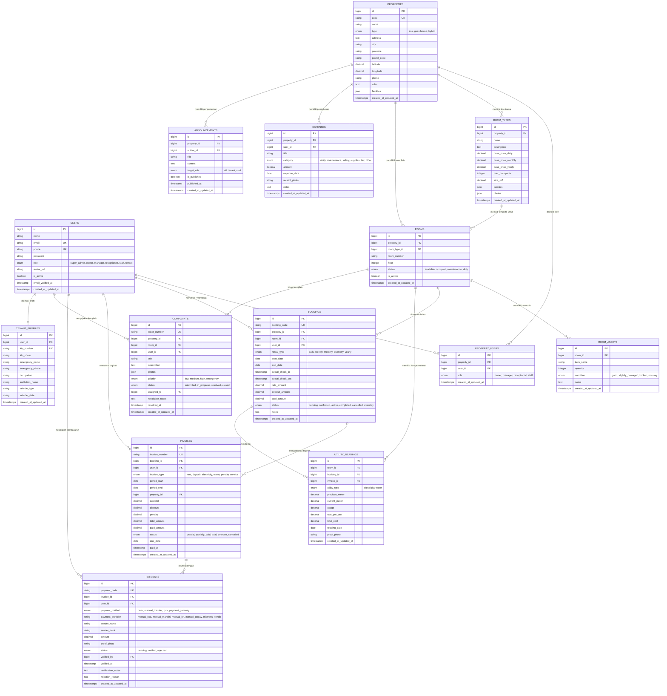

# Desain ERD & Skema Database - SIM Kos & Guesthouse

Dokumen ini berisi rancangan relasi basis data (Entity Relationship Diagram), kamus data lengkap, indexing, dan aturan integritas relasional untuk **SIM Kos & Guesthouse**.

---

## 1. Diagram Relasi Entitas (Mermaid ERD)

---

## 2. Kamus Data & Indexing

### Tabel: `users`
- **Fungsi**: Menyimpan akun pengguna semua peran.
- **Index**:
  - `PRIMARY KEY (id)`
  - `UNIQUE (email)`
  - `UNIQUE (phone)`
  - `INDEX (role, is_active)`

### Tabel: `properties`
- **Fungsi**: Menyimpan unit properti (Kos Putri / Kos Putra / Guesthouse).
- **Index**:
  - `PRIMARY KEY (id)`
  - `UNIQUE (code)`
  - `INDEX (city, type)`

### Tabel: `rooms`
- **Fungsi**: Menyimpan kamar fisik spesifik pada properti.
- **Index**:
  - `PRIMARY KEY (id)`
  - `UNIQUE (property_id, room_number)`
  - `INDEX (status, is_active)`
  - `FOREIGN KEY (property_id) REFERENCES properties(id) ON DELETE CASCADE`
  - `FOREIGN KEY (room_type_id) REFERENCES room_types(id) ON DELETE RESTRICT`

### Tabel: `bookings`
- **Fungsi**: Transaksi penyewaan jangka panjang (Kos) maupun reservasi jangka pendek (Guesthouse).
- **Index**:
  - `PRIMARY KEY (id)`
  - `UNIQUE (booking_code)`
  - `INDEX (room_id, start_date, end_date, status)`
  - `INDEX (user_id, status)`
  - `FOREIGN KEY (property_id) REFERENCES properties(id)`
  - `FOREIGN KEY (room_id) REFERENCES rooms(id)`
  - `FOREIGN KEY (user_id) REFERENCES users(id)`

### Tabel: `invoices`
- **Fungsi**: Catatan kewajiban bayar penyewa (biaya sewa, deposit, listrik, denda overstay).
- **Index**:
  - `PRIMARY KEY (id)`
  - `UNIQUE (invoice_number)`
  - `INDEX (booking_id, status, due_date)`
  - `INDEX (user_id, status)`
  - `FOREIGN KEY (booking_id) REFERENCES bookings(id) ON DELETE CASCADE`
  - `FOREIGN KEY (user_id) REFERENCES users(id)`

### Tabel: `payments`
- **Fungsi**: Rekam jejak transaksi pembayaran masuk.
- **Index**:
  - `PRIMARY KEY (id)`
  - `UNIQUE (payment_code)`
  - `INDEX (invoice_id, status)`
  - `FOREIGN KEY (invoice_id) REFERENCES invoices(id) ON DELETE CASCADE`
  - `FOREIGN KEY (user_id) REFERENCES users(id)`
  - `FOREIGN KEY (verified_by) REFERENCES users(id)`

---

## 3. Aturan Integritas & Anti-Double Booking

1. **Pencegahan Overlapping Booking**:
   Sebelum status booking diubah menjadi `confirmed` atau `active`, sistem mengecek apakah ada booking lain pada `room_id` yang sama dengan rentang waktu beririsan:
   $$\text{Existing.start\_date} < \text{New.end\_date} \quad \text{AND} \quad \text{Existing.end\_date} > \text{New.start\_date}$$
   dengan status `IN ('confirmed', 'active')`.
2. **Kunci Kamar Saat Maintenance**:
   Kamar berstatus `maintenance` atau `dirty` tidak dapat dipilih untuk booking instan sebelum statusnya dikembalikan ke `available` oleh staf housekeeping/pengelola.
3. **Penyimpanan Nilai Uang**:
   Seluruh nilai uang menggunakan tipe data `DECIMAL(14, 2)` guna mencegah kehilangan presisi akibat floating point rounding.
