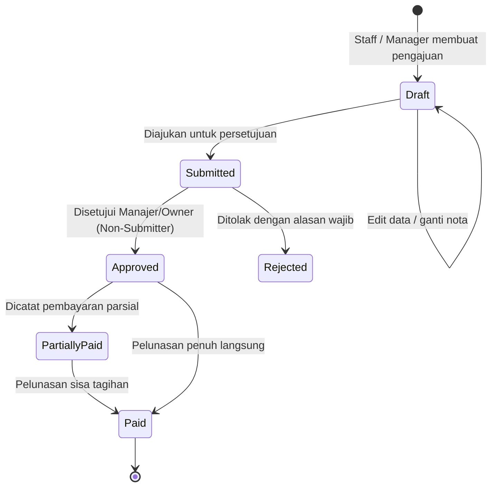

# Alur Kerja Keuangan & Analitik Bisnis (Phase 6)
**SIM Kos & Guesthouse**

Dokumen ini menjelaskan alur bisnis, aturan pengakuan transaksi, otorisasi peran, pemisahan tugas (*Segregation of Duties*), serta perhitungan analitik pada modul keuangan Phase 6.

---

## 1. Prinsip Utama Pengakuan Finansial

1. **Pengakuan Kas Masuk (Penerimaan)**:
   - Invoice adalah tagihan yang diterbitkan, **bukan** kas masuk.
   - Kas masuk diakui **hanya** jika pembayaran (`payments`) berstatus **`verified`**.
   - Pembayaran sebagian (*partial payment*) hanya menambah kas masuk sebesar nominal yang benar-benar diterima dan diverifikasi.
2. **Pengakuan Kas Keluar (Pengeluaran Operasional)**:
   - Pengeluaran yang baru dibuat (`draft`) atau diajukan (`submitted`) **bukan** kas keluar.
   - Pengeluaran yang telah disetujui (`approved`) berstatus kewajiban siap bayar, tetapi **belum** mengurangi kas riil hingga dicatat di tabel `expense_payments`.
   - Realisasi kas keluar dihitung dari pencatatan pembayaran pengeluaran (`expense_payments.amount`).
3. **Pencegahan Penghitungan Ganda (No Double-Counting)**:
   - Pendapatan utilitas dan sewa kamar bersumber langsung dari pembayaran invoice yang sama. Sistem tidak membuat tabel atau record pendapatan terpisah yang rawan duplikasi.
4. **Ringkasan Hasil Usaha (Cash-Basis Operating Summary)**:
   - Hasil Usaha = Total Penerimaan Kas Terverifikasi - Total Pengeluaran Kas Dibayar.
   - Dilabeli secara transparan sebagai **Ringkasan Hasil Usaha Operasional Berbasis Arus Kas**, bukan laba bersih akuntansi akrual GAAP komersial.

---

## 2. Siklus Hidup Pengeluaran Operasional (Expense Lifecycle)

### Status Approval:
- `draft`: Draf pengeluaran yang masih dapat diedit oleh pembuat.
- `submitted`: Pengeluaran telah diajukan dan terkunci untuk ditinjau oleh penyetuju berwenang.
- `approved`: Pengeluaran disetujui dan siap dicatat pembayarannya.
- `rejected`: Pengajuan ditolak dengan alasan penolakan wajib tercatat di audit trail.

### Status Pembayaran:
- `unpaid`: Belum ada pembayaran yang dicatat.
- `partially_paid`: Pembayaran telah dilakukan sebagian (`0 < paid_amount < amount`).
- `paid`: Pengeluaran lunas terbayar (`paid_amount == amount`).

---

## 3. Pemisahan Tugas (Segregation of Duties) & Keamanan

1. **Larangan Persetujuan Sendiri (No Self-Approval)**:
   - Pengguna yang mengajukan pengeluaran (`user_id == auth()->id()`) dilarang keras menyetujui pengajuannya sendiri, kecuali Super Administrator dalam kondisi darurat.
   - Sistem melempar `DomainException: Pemisahan tugas (Segregation of Duties): Pengaju tidak diperbolehkan menyetujui pengajuannya sendiri.`
2. **Kewenangan Penyetuju**:
   - Hanya peran `super_admin`, `owner`, dan `manager` yang memiliki akses ke cabang properti terkait yang dapat menyetujui atau menolak pengeluaran.
   - Peran `receptionist`, `staff`, dan `tenant` dilarang menyetujui atau menolak pengeluaran operasional.
3. **Pencegahan Kelebihan Bayar (Overpayment Guard)**:
   - Nominal pembayaran yang dicatat divalidasi tidak boleh melebihi sisa tagihan (`remaining_balance = amount - paid_amount`).
   - Eksekusi menggunakan transaksi database dan *row locking* (`lockForUpdate`) untuk mencegah duplikasi pembayaran pada request konkuren.
4. **Perlindungan Bukti Transaksi Sensitif**:
   - Nota, kuitansi, dan bukti transfer disimpan di disk privat (`private/expenses/*`).
   - Akses file divalidasi di backend berdasarkan properti dan peran pengguna. Penyewa dilarang keras mengakses bukti pengeluaran operasional.

---

## 4. Definisi KPI dan Laporan Finansial

| Laporan / KPI | Formula / Definisi | Sumber Data Utama |
| :--- | :--- | :--- |
| **Penerimaan Kas (Masuk)** | `SUM(payments.amount)` dengan status `verified` pada rentang tanggal | Tabel `payments` relasi `invoices` |
| **Pengeluaran Kas (Keluar)** | `SUM(expense_payments.amount)` pada rentang tanggal | Tabel `expense_payments` relasi `expenses` |
| **Arus Kas Bersih (Net Cash)** | `Penerimaan Kas - Pengeluaran Kas` | Selisih kas riil masuk dan keluar |
| **Total Sisa Piutang** | `SUM(total_amount - paid_amount)` invoice `unpaid` & `partially_paid` | Tabel `invoices` |
| **Aging Piutang** | Pengelompokan umur jatuh tempo: 0–30 hari, 31–60 hari, 61–90 hari, >90 hari | `invoices.due_date` vs tanggal hari ini |
| **Tingkat Okupansi** | `(Kamar Terisi / Total Kamar) * 100%` | Tabel `rooms` (`status = 'occupied'`) |
| **Tiket Maintenance Berjalan**| Jumlah tiket perbaikan berstatus belum selesai verifikasi | Tabel `maintenances` |
