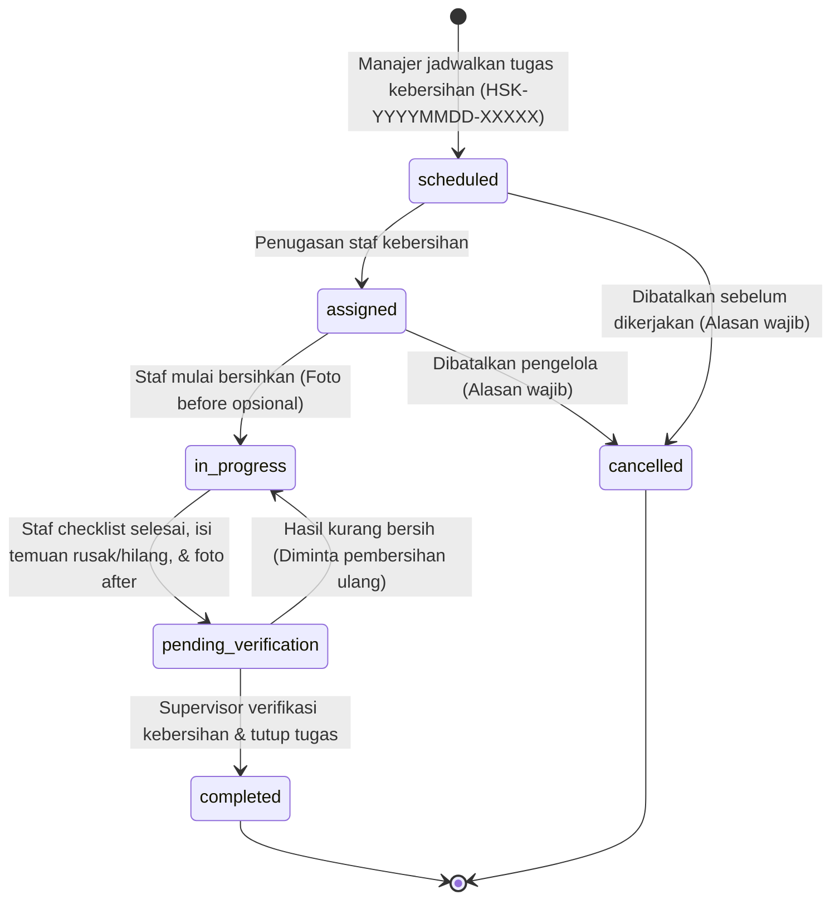

# Housekeeping Management Workflow - SIM Kos & Guesthouse

Dokumen ini menjelaskan alur penjadwalan kebersihan kamar dan area umum, eksekusi checklist, pelaporan barang rusak/hilang, verifikasi supervisor, dan pencegahan tugas aktif duplikat.

---

## 1. Alur & State Machine Tugas Kebersihan (Housekeeping)



### Penjelasan Transisi Status
1. **`scheduled`**:
   - Tugas kebersihan dijadwalkan oleh manajer/owner untuk kamar tertentu atau area bersama (misal: Lobby, Dapur Bersama).
   - Dilengkapi tanggal pelaksanaan, sesi slot waktu (Pagi, Siang, Sore), dan prioritas.
   - Sistem secara otomatis menginisialisasi checklist tugas bawaan sesuai tipe pembersihan.
2. **`assigned`**:
   - Petugas kebersihan (staf) yang terdaftar di properti terkait ditugaskan.
3. **`in_progress`**:
   - Petugas menekan tombol "Mulai Bersihkan". Foto kondisi awal kamar dapat diunggah sebagai bukti.
4. **`pending_verification`**:
   - Petugas mencentang setiap item checklist yang telah selesai dikerjakan.
   - Mengunggah foto hasil pembersihan (`photos_after`).
   - Melaporkan jika ada temuan barang inventaris kamar yang retak, rusak, atau hilang (`damaged_or_missing_items`).
   - Tugas diserahkan untuk diverifikasi pengawas.
5. **`completed`**:
   - Supervisor atau Manajer memeriksa kondisi fisik kamar.
   - Mengisi catatan evaluasi (`verification_notes`) dan menutup tugas.
   - Tanggal dan aktor verifikator (`verified_at`, `verified_by`) terekam ke log audit.
6. **`cancelled`**:
   - Pembatalan tugas mencatat `cancellation_reason` dan pengguna yang membatalkan.

---

## 2. Checklist Kebersihan Terkonfigurasi

Setiap tugas kebersihan membawa daftar butir checklist terstruktur:
```json
[
  {"id": 1, "task": "Sapu dan pel lantai hingga bersih", "is_done": true, "category": "kamar"},
  {"id": 2, "task": "Ganti sprei dan sarung bantal bersih", "is_done": true, "category": "kamar"},
  {"id": 3, "task": "Kuras bak & bersihkan kloset kamar mandi", "is_done": true, "category": "kamar_mandi"},
  {"id": 4, "task": "Lap kaca cermin dan jendela", "is_done": true, "category": "kamar"},
  {"id": 5, "task": "Buang sampah kamar & pasang trash bag baru", "is_done": true, "category": "kamar"}
]
```

Petugas wajib mencentang setiap butir yang telah tuntas sebelum mengajukan tugas untuk verifikasi.

---

## 3. Pencegahan Tugas Aktif Duplikat (Anti-Duplicate Guard)

Untuk menjaga ketertiban jadwal kerja staf dan menghindari pembersihan ganda:
- Sistem memvalidasi apakah ada tugas aktif (`scheduled`, `assigned`, `in_progress`, `pending_verification`) untuk `room_id` yang sama pada `scheduled_date` yang sama.
- Jika ditemukan, permintaan penjadwalan baru otomatis ditolak dengan pesan:
  `"Sudah ada tugas kebersihan aktif untuk kamar ini pada tanggal {tanggal}. Gunakan tugas yang sudah ada atau batalkan terlebih dahulu."` (HTTP 422).
- Pengecualian hanya diizinkan apabila pengelola menyertakan flag eksplisit `allow_duplicate = true`.

---

## 4. Pemisahan dari Siklus Hidup Kamar (Decoupling Rule)

Pengerjaan housekeeping **TIDAK PERNAH** secara otomatis:
1. Mengubah status booking penyewa (misal check-in / check-out otomatis).
2. Memindahkan penyewa ke kamar lain.
3. Mendeklarasikan kamar tersedia (`available`) tanpa melalui validasi pengelola kamar dan penyelesaian rental workflow.
Hal ini menjaga batas pemisahan tanggung jawab antara modul kebersihan dan modul manajemen inventaris/sewa.
