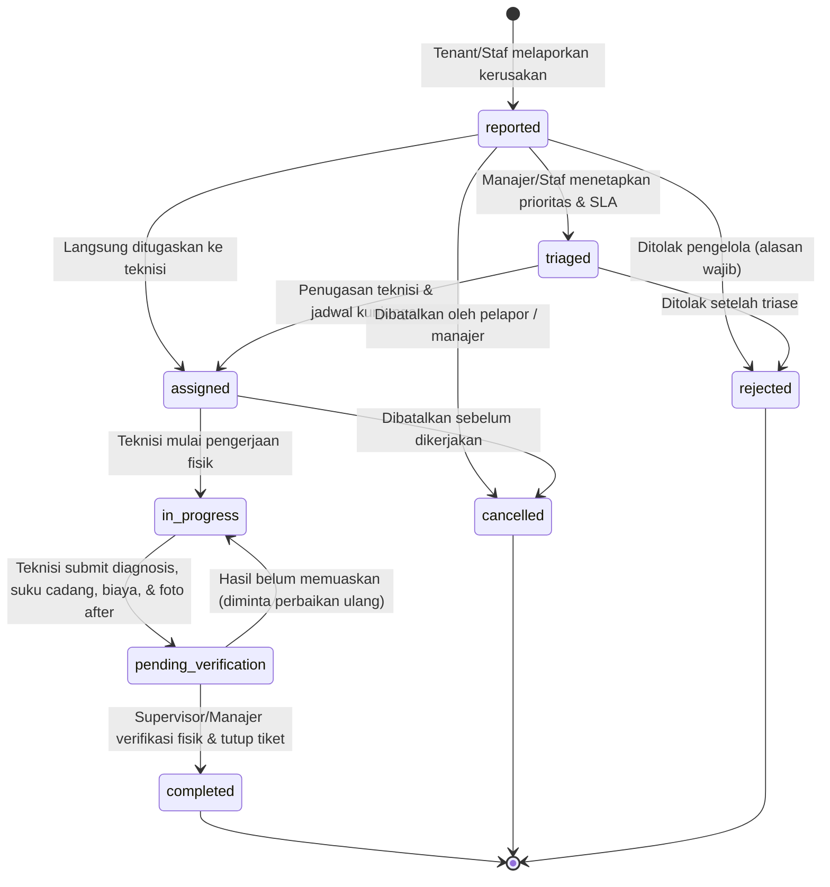

# Maintenance Management Workflow - SIM Kos & Guesthouse

Dokumen ini menjelaskan alur kerja operasional, state machine, batas SLA, verifikasi supervisor, dan struktur audit log untuk modul perbaikan (Maintenance Management).

---

## 1. Siklus Hidup & State Machine Tiket Maintenance

### Penjelasan Transisi Status
1. **`reported`**:
   - Tiket dibuat oleh penyewa (terikat kamar aktif) atau staf operasional (kamar atau area umum).
   - Foto kondisi awal (`photos_before`) dapat dilampirkan.
   - Sistem otomatis menghitung `sla_due_at` awal berdasarkan default normal prioritas.
2. **`triaged`**:
   - Pengelola/staf meninjau tingkat keparahan, kategori kerusakan, dan mengkoreksi prioritas (low, normal, high, urgent).
   - Jam SLA dan `sla_due_at` diperbarui otomatis.
3. **`assigned`**:
   - Penetapan teknisi atau staf pelaksana yang terikat pada cabang properti terkait.
   - Jadwal estimasi pengerjaan dicatat. Notifikasi penugasan dikirimkan ke teknisi.
4. **`in_progress`**:
   - Teknisi menekan tombol "Mulai Pengerjaan" saat tiba di lokasi. Catatan diagnosis awal dapat disimpan.
5. **`pending_verification`**:
   - Teknisi menyelesaikan perbaikan fisik di kamar/lokasi.
   - Teknisi mencatat:
     - Tindakan yang dilakukan (`action_taken`).
     - Suku cadang yang diganti (`spare_parts`).
     - Biaya tenaga kerja (`labor_cost`) dan biaya bahan (`material_cost`), menghasilkan `total_cost`.
     - Foto bukti sesudah pengerjaan (`photos_after`).
   - Tiket berpindah ke status menunggu verifikasi supervisor. Teknisi **TIDAK DAPAT** menyatakan tiket selesai secara sepihak.
6. **`completed`**:
   - Supervisor / Manager memeriksa langsung hasil pengerjaan atau meninjau bukti foto dan pengeluaran suku cadang.
   - Supervisor mengisi `verification_notes` dan menandai tiket selesai.
   - Cap waktu `verified_at` dan identitas `verified_by` terekam permanen.
7. **`cancelled` / `rejected`**:
   - Tiket yang dibatalkan atau ditolak wajib menyertakan alasan (`cancellation_reason` / `rejection_reason`).

---

## 2. Kategori Kerusakan & Batas Waktu SLA

| Kategori Kerusakan | Kode Enum | Target Prioritas Default | Durasi SLA Maksimal |
| :--- | :--- | :--- | :--- |
| **Kelistrikan** | `electricity` | High / Urgent | 6 - 24 Jam |
| **Saluran Air / Kebocoran** | `water` | High | 24 Jam |
| **Plumbing / Pipa Sanitasi** | `plumbing` | High | 24 Jam |
| **Pendingin Ruangan (AC)** | `ac` | Normal / High | 24 - 48 Jam |
| **Pintu / Kunci / Jendela** | `door_lock` | High / Urgent | 6 - 24 Jam |
| **Jaringan WiFi / Internet** | `internet` | Normal | 48 Jam |
| **Perabot / Furnitur** | `furniture` | Normal / Low | 48 - 72 Jam |
| **Kebersihan Ekstra** | `cleanliness` | Normal | 48 Jam |
| **Lain-lain** | `other` | Normal | 48 Jam |

### Aturan Jam SLA:
- **Urgent**: 6 Jam (Kasus darurat: korsleting api, pipa utama pecah, kunci pintu utama macet total).
- **High**: 24 Jam.
- **Normal**: 48 Jam.
- **Low**: 72 Jam.

Setiap tiket memiliki penanda otomatis `is_overdue` apabila waktu saat ini melewati `sla_due_at` dan status belum `completed`.

---

## 3. Keamanan File Bukti Foto & Hak Akses

- Seluruh foto kondisi sebelum (`photos_before`) dan sesudah (`photos_after`) disimpan pada storage privat lokal:
  `storage/app/private/maintenance_photos/{ticket_number}/...`
- Akses foto hanya dilayani melalui endpoint otentikasi:
  `GET /api/v1/maintenance/{id}/photo?path=...`
  dan dashboard web:
  `GET /dashboard/maintenance/{id}/photo?path=...`
- Server memvalidasi:
  1. Penyewa hanya dapat melihat foto dari tiket miliknya sendiri atau kamar aktifnya.
  2. Staf, Manajer, dan Owner hanya dapat melihat foto dari cabang properti yang ditugaskan kepada mereka.
  3. Akses pihak ketiga tanpa sesi atau lintas properti ditolak dengan `403 Forbidden`.
