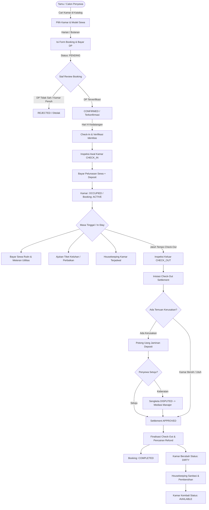
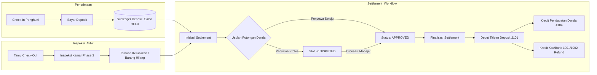
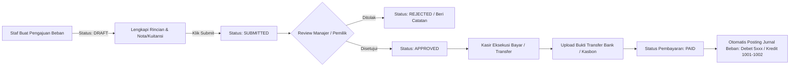

# PANDUAN PENGGUNAAN & DOKUMENTASI ALUR SISTEM LENGKAP
## SISTEM INFORMASI MANAJEMEN (SIM) KOS & GUESTHOUSE

---

## DAFTAR ISI

1. [GAMBARAN UMUM SISTEM & ARSITEKTUR](#1-gambaran-umum-sistem--arsitektur)
2. [MATRIKS PERAN & HAK AKSES PENGGUNA (RBAC)](#2-matriks-peran--hak-akses-pengguna-rbac)
3. [BAGAN ALIR BISNIS UTAMA (END-TO-END FLOWCHARTS)](#3-bagan-alir-bisnis-utama-end-to-end-flowcharts)
4. [ALUR PENGGUNAAN TAHAP DEMI TAHAP (STEP-BY-STEP WORKFLOW)](#4-alur-penggunaan-tahap-demi-tahap-step-by-step-workflow)
   - [4.1 Alur Tamu Publik: Pencarian, Booking, & Pembayaran DP](#41-alur-tamu-publik-pencarian-booking--pembayaran-dp)
   - [4.2 Alur Staf: Verifikasi Reservasi & Persiapan Kamar](#42-alur-staf-verifikasi-reservasi--persiapan-kamar)
   - [4.3 Alur Check-In & Onboarding Penghuni](#43-alur-check-in--onboarding-penghuni)
   - [4.4 Alur Operasional Selama Masa Tinggal (Stay Lifecycle)](#44-alur-operasional-selama-masa-tinggal-stay-lifecycle)
     - [A. Tagihan Sewa & Verifikasi Pembayaran](#a-tagihan-sewa--verifikasi-pembayaran)
     - [B. Manajemen Utilitas Listrik & Air](#b-manajemen-utilitas-listrik--air)
     - [C. Layanan Pembersihan Kamar (Housekeeping)](#c-layanan-pembersihan-kamar-housekeeping)
     - [D. Pemeliharaan & Perbaikan Kerusakan (Maintenance)](#d-pemeliharaan--perbaikan-kerusakan-maintenance)
     - [E. Penanganan Keluhan Penghuni (Complaints)](#e-penanganan-keluhan-penghuni-complaints)
   - [4.5 Alur Pengeluaran Operasional (Operational Expenses)](#45-alur-pengeluaran-operasional-operational-expenses)
   - [4.6 Alur Check-Out, Inspeksi Akhir, & Settlement Uang Jaminan (Deposit)](#46-alur-check-out-inspeksi-akhir--settlement-uang-jaminan-deposit)
   - [4.7 Alur Akuntansi Double-Entry & Laporan Finansial](#47-alur-akuntansi-double-entry--laporan-finansial)
5. [PANDUAN OPERASIONAL WEB DASHBOARD (LARAVEL BLADE)](#5-panduan-operasional-web-dashboard-laravel-blade)
6. [PANDUAN OPERASIONAL APLIKASI MOBILE (FLUTTER)](#6-panduan-operasional-aplikasi-mobile-flutter)
7. [TATA KELOLA STATUS SISTEM (SYSTEM ENUMS & STATE TRANSITIONS)](#7-tata-kelola-status-sistem-system-enums--state-transitions)
8. [PANDUAN PENANGANAN MASALAH (TROUBLESHOOTING & FAQ)](#8-panduan-penanganan-masalah-troubleshooting--faq)

---

## 1. GAMBARAN UMUM SISTEM & ARSITEKTUR

SIM Kos & Guesthouse adalah platform terpadu pengelolaan properti sewa kamar harian (guesthouse) maupun sewa jangka panjang (kos bulanan/tahunan). Sistem ini mengintegrasikan seluruh proses bisnis mulai dari pemasaran publik, reservasi, check-in, operasional kebersihan/fasilitas, pencatatan meteran utilitas, pencatatan transaksi kasir, subledger uang jaminan (deposit), hingga pembukuan akuntansi double-entry otomatis multi-cabang.

### Ekosistem Platform:
1. **Backend REST API (Laravel 13)**: Engine pusat pengolah aturan bisnis, autentikasi berbasis Sanctum/Session, isolasi multi-properti, transaksi atomik database, serta generator jurnal double-entry otomatis.
2. **Web Dashboard (Laravel Blade + Bootstrap 5)**: Panel admin responsif dengan sidebar vertikal modern, form drawer kanan (*offcanvas*), dialog modal konfirmasi, dan laporan analitik untuk pemilik, manajer, kasir, serta staf administrasi.
3. **Aplikasi Mobile (Flutter Android & iOS)**: Aplikasi native portabel untuk penghuni (melihat tagihan, lapor keluhan, pantau deposit) dan staf lapangan (pencatatan angka meteran fisik, checklist inspeksi, dan penugasan kebersihan/maintenance).
4. **Portal Tamu Publik (Web Catalog & Guest Booking)**: Antarmuka publik tanpa login untuk melihat ketersediaan kamar, simulasi tarif sewa, pemesanan mandiri, pembayaran uang muka (DP), dan pelacakan status pesanan secara transparan.

---

## 2. MATRIKS PERAN & HAK AKSES PENGGUNA (RBAC)

Sistem menerapkan kontrol akses berbasis peran (*Role-Based Access Control*) dengan isolasi properti terikat (*property scoping*):

| Modul / Fitur | Super Admin | Owner (Pemilik) | Manager (Pengelola) | Receptionist (Resepsionis) | Staff (Housekeeping / Maint.) | Tenant (Penghuni) | Tamu Publik |
|---|:---:|:---:|:---:|:---:|:---:|:---:|:---:|
| **Katalog & Cek Ketersediaan Kamar** | ✅ | ✅ | ✅ | ✅ | ✅ | ✅ | ✅ |
| **Reservasi Mandiri & Booking Online** | ✅ | ✅ | ✅ | ✅ | ❌ | ❌ | ✅ |
| **Konfirmasi / Penolakan Reservasi** | ✅ | ✅ | ✅ | ✅ | ❌ | ❌ | ❌ |
| **Check-In Penghuni** | ✅ | ✅ | ✅ | ✅ | ✅ | ❌ | ❌ |
| **Verifikasi Pembayaran & Kasir** | ✅ | ✅ | ✅ | ✅ | ❌ | ❌ | ❌ |
| **Pencatatan Meteran Listrik/Air** | ✅ | ✅ | ✅ | ✅ | ✅ | ❌ | ❌ |
| **Penerbitan Invoice Utilitas** | ✅ | ✅ | ✅ | ✅ | ❌ | ❌ | ❌ |
| **Tugas Housekeeping & Sanitasi** | ✅ | ✅ | ✅ | ✅ | ✅ | ❌ | ❌ |
| **Tiket Kerusakan (Maintenance)** | ✅ | ✅ | ✅ | ✅ | ✅ (Pengerjaan) | ✅ (Pelapor) | ❌ |
| **Tiket Keluhan (Complaints)** | ✅ | ✅ | ✅ | ✅ | ❌ | ✅ (Pelapor) | ❌ |
| **Inspeksi Kamar (Check-In/Out)** | ✅ | ✅ | ✅ | ✅ | ✅ | ✅ (Review/Approve) | ❌ |
| **Pengajuan Beban Operasional** | ✅ | ✅ | ✅ | ✅ | ✅ | ❌ | ❌ |
| **Persetujuan (Approval) Beban** | ✅ | ✅ | ✅ (Limit Cabang) | ❌ | ❌ | ❌ | ❌ |
| **Pencairan & Pembayaran Beban** | ✅ | ✅ | ✅ | ❌ | ❌ | ❌ | ❌ |
| **Inisiasi Check-Out Settlement** | ✅ | ✅ | ✅ | ✅ | ❌ | ❌ | ❌ |
| **Sanggahan Denda (Dispute)** | ❌ | ❌ | ❌ | ❌ | ❌ | ✅ | ❌ |
| **Resolusi Sengketa Denda Deposit** | ✅ | ✅ | ✅ | ❌ | ❌ | ❌ | ❌ |
| **Finalisasi Check-Out & Refund** | ✅ | ✅ | ✅ | ❌ | ❌ | ❌ | ❌ |
| **Jurnal Umum & COA Akuntansi** | ✅ | ✅ | ✅ | ❌ | ❌ | ❌ | ❌ |
| **Laporan Finansial & Tutup Buku** | ✅ | ✅ | ✅ | ❌ | ❌ | ❌ | ❌ |

---

## 3. BAGAN ALIR BISNIS UTAMA (END-TO-END FLOWCHARTS)

### 3.1 Siklus Hidup Penghuni & Kamar (Stay Lifecycle)



### 3.2 Alur Uang Jaminan (Deposit) & Check-Out Settlement



---

## 4. ALUR PENGGUNAAN TAHAP DEMI TAHAP (STEP-BY-STEP WORKFLOW)

### 4.1 Alur Tamu Publik: Pencarian, Booking, & Pembayaran DP

Tamu publik tidak diwajibkan memiliki akun terlebih dahulu untuk melakukan reservasi:

1. **Akses Katalog Kamar**:
   - Buka alamat beranda website publik (`/` atau `/catalog`).
   - Gunakan filter pencarian: Properti kos/guesthouse, tipe sewa (harian, bulanan), rentang tarif, dan fasilitas (AC, WiFi, Kamar Mandi Dalam).
2. **Pilih Kamar & Simulasi Biaya**:
   - Klik kartu kamar untuk melihat galeri foto, ukuran, dan aturan hunian (`/rooms/{id}`).
   - Sistem menjalankan pengecekan kalender secara realtime untuk memastikan kamar tidak bentrok (*availability engine*).
   - Masukkan tanggal mulai (*check-in*) dan durasi sewa. Sistem menghitung total biaya sewa dan nominal Down Payment (DP) wajib secara transparan.
3. **Pengisian Data Reservasi**:
   - Klik **"Pesan Kamar Sekarang"** (`/booking/create`).
   - Masukkan data identitas: Nama lengkap, No. WhatsApp aktif, alamat email, dan No. KTP / NIK.
   - Cantumkan catatan khusus (misal: estimasi jam kedatangan).
4. **Pembayaran DP & Tracking Token**:
   - Formulir menampilkan nomor rekening resmi bank kos.
   - Calon penyewa mentransfer DP dan mengunggah foto struk/screenshot bukti transfer.
   - Setelah formulir dikirim, sistem menerbitkan **Kode Booking unik** (misal: `BKG-20261018-AB12`) dan **Secure Tracking Token**.
   - Tamu diarahkan ke halaman pelacakan status pesanan (`/booking/track/{token}`) yang dapat dipantau setiap saat tanpa login.

---

### 4.2 Alur Staf: Verifikasi Reservasi & Persiapan Kamar

1. **Notifikasi Pemesanan Masuk**:
   - Resepsionis atau Manajer membuka menu **Operasional Sewa > Pemesanan (Booking)** (`/dashboard/bookings`).
   - Pesanan baru berstatus badge kuning: **Menunggu Pembayaran / Review (`PENDING`)**.
2. **Verifikasi Bukti Pembayaran**:
   - Staf membuka detail pemesanan, memeriksa keabsahan mutasi bank terhadap bukti transfer yang diunggah.
3. **Keputusan Staf**:
   - **Konfirmasi Booking**: Klik tombol **"Konfirmasi Booking"** (Modal konfirmasi). Status pemesanan berubah menjadi **Terkonfirmasi (`CONFIRMED`)**. Kamar di-booking secara eksklusif dan dicegah dari pesanan ganda (*anti-double booking lock*).
   - **Tolak Booking**: Jika bukti palsu atau kamar mendadak terkendala teknis, klik **"Tolak"** dan wajib mengisi alasan penolakan. Tagihan dibatalkan otomatis dan tamu menerima pemberitahuan via halaman pelacakan.

---

### 4.3 Alur Check-In & Onboarding Penghuni

Tahap serah terima kamar saat tamu/penyewa tiba di properti:

1. **Verifikasi Fisik**:
   - Tamu menunjukkan KTP asli dan kode booking kepada resepsionis.
2. **Penerbitan Tagihan Pelunasan & Uang Jaminan**:
   - Sistem menerbitkan invoice pelunasan sisa sewa serta tagihan **Uang Jaminan (Security Deposit)** sesuai kebijakan properti (misal: Rp 1.000.000 untuk kos bulanan).
   - Kasir mencatat penerimaan pelunasan di menu **Verifikasi Pembayaran** (`/dashboard/payments`).
   - Saldo deposit otomatis masuk ke **Subledger Uang Jaminan** dengan status **Tertahan (`HELD`)** dan menjurnal otomatis:
     - `DEBET`: Kas / Bank (`1001`/`1002`)
     - `KREDIT`: Titipan Uang Jaminan (`2101`)
3. **Inspeksi Masuk Kamar (Check-In Inspection)**:
   - Petugas membuka menu **Fasilitas & Layanan > Inspeksi Kamar** (`/dashboard/inspections`).
   - Buat inspeksi baru bertipe `CHECK_IN`.
   - Periksa aset kamar satu per satu (Kondisi kasur, kebersihan sprei, fungsi AC, remot TV, saklar lampu, kran air).
   - Unggah foto kondisi awal kamar dan minta tanda tangan/persetujuan penyewa pada aplikasi mobile/web.
4. **Eksekusi Check-In**:
   - Buka kembali detail booking, klik tombol hijau **"Proses Check-In"**.
   - Sistem secara atomik:
     - Mengubah status Booking menjadi **Aktif (`ACTIVE`)**.
     - Mencatat timestamp `actual_check_in`.
     - Mengubah status kamar menjadi **Terisi (`OCCUPIED`)**.
     - Menyerahkan kunci fisik / kartu akses kamar ke penghuni.

---

### 4.4 Alur Operasional Selama Masa Tinggal (Stay Lifecycle)

#### A. Tagihan Sewa & Verifikasi Pembayaran
- Setiap periode sewa baru (misal: tanggal 1 setiap bulan), sistem mengenerate invoice sewa otomatis.
- Penghuni menerima invoice via mobile/email dan melakukan pembayaran.
- Kasir membuka menu **Operasional Sewa > Verifikasi Pembayaran**:
  - Periksa bukti bayar via tombol pratinjau (*stream proof*).
  - Klik **"Verifikasi Lunas"** jika dana telah efektif masuk rekening.
  - Sistem otomatis menerbitkan kwitansi sah bernomor seri unik dan memposting jurnal pendapatan sewa (`KREDIT 4101`).

#### B. Manajemen Utilitas Listrik & Air
Pengelolaan meteran mandiri (*individual meter*) per kamar maupun meteran induk:
1. **Pencatatan Angka Meter (Meter Reading)**:
   - Petugas lapangan berkeliling membawa aplikasi mobile atau membuka web menu **Utilitas & Meteran > Pencatatan & Review** (`/dashboard/utilities/readings`).
   - Buka tombol **"Catat Meteran Baru"** (Form Drawer).
   - Masukkan angka stand meter terkini dan ambil foto fisik meteran sebagai bukti tak terbantahkan.
2. **Validasi Pemakaian & Anti-Mundur**:
   - Sistem otomatis menghitung pemakaian: `Konsumsi = Stand Terkini - Stand Sebelumnya`.
   - Sistem menolak input jika angka meter lebih kecil dari stand lalu (*anti-backward error*).
3. **Pratinjau Tagihan & Penerbitan Invoice**:
   - Pengelola memeriksa menu review meteran.
   - Klik **"Generate Invoice Utilitas"**. Sistem menghitung tagihan berdasarkan tarif progresif/flat per kWh atau per m³.
   - Invoice utilitas terbit dan langsung muncul pada aplikasi mobile penghuni.

#### C. Layanan Pembersihan Kamar (Housekeeping)
1. Penugasan otomatis saat kamar berstatus **Kotor (`DIRTY`)** pasca check-out atau permintaan harian guesthouse.
2. Staf membuka menu **Fasilitas & Layanan > Kebersihan (Housekeeping)** (`/dashboard/housekeeping`).
3. Petugas mengklik **"Mulai Pembersihan"** (`status: in_progress`).
4. Jalankan checklist: Sapu & pel lantai, ganti sprei/sarung bantal, pembersihan toilet, pengisian handuk & amenities.
5. Unggah foto hasil kebersihan dan klik **"Selesai & Minta Verifikasi"**.
6. Supervisor memeriksa hasil kamar; jika memenuhi standar bintang, klik **"Verifikasi Bersih"**. Status kamar otomatis beralih menjadi **Tersedia (`AVAILABLE`)** dan siap disewakan kembali.

#### D. Pemeliharaan & Perbaikan Kerusakan (Maintenance)
1. Tiket kerusakan dapat dibuat oleh penghuni via mobile atau dilaporkan staf via web (`/dashboard/maintenance`).
2. **Triage & Penugasan**:
   - Manajer meninjau foto kerusakan dan menetapkan prioritas: `LOW`, `MEDIUM`, `HIGH`, `EMERGENCY`.
   - Menugaskan staf teknisi internal atau vendor rekanan.
3. **Pengerjaan & Pencatatan Biaya**:
   - Teknisi mengklik **"Mulai Perbaikan"**.
   - Jika membutuhkan sparepart, teknisi mencatat pengeluaran material.
4. **Verifikasi Hasil Kerja**:
   - Teknisi mengunggah foto perbaikan selesai.
   - Manajer atau penghuni memverifikasi fungsi aset; jika tuntas, tiket ditutup (`status: completed`).

#### E. Penanganan Keluhan Penghuni (Complaints)
1. Penghuni mengajukan tiket komplain via mobile (misal: tetangga kamar bising, air pompa mati, internet lambat).
2. Resepsionis menerima tiket di menu **Keluhan Penghuni** (`/dashboard/complaints`).
3. Resepsionis merespon dengan catatan tindak lanjut dan menugaskan staf terkait (`status: in_progress`).
4. Jika keluhan berakar dari kerusakan fisik, staf dapat langsung menghubungkan tiket komplain ke modul Maintenance melalui tombol **"Link to Maintenance"**.
5. Setelah masalah teratasi, staf mengklik **"Selesaikan Komplain"**. Penghuni dapat memberikan rating kepuasan atau membuka kembali (*reopen*) jika kendala belum tuntas.

---

### 4.5 Alur Pengeluaran Operasional (Operational Expenses)

Sistem mengamankan tata kelola kas keluar melalui alur persetujuan bertingkat (*multi-tier approval workflow*):



1. **Pengajuan Pengeluaran Baru**:
   - Buka menu **Finansial & Laporan > Pengeluaran Operasional** (`/dashboard/expenses`).
   - Klik **"Catat Pengeluaran Baru"**.
   - Pilih Kategori Beban (Listrik Gedung, Wifi Utama, Gaji Karyawan, Pembelian Sabun/Sprei, Renovasi Bangunan).
   - Masukkan nominal, tanggal transaksi, penerima dana, dan lampirkan bukti nota/invoice vendor.
2. **Pengajuan ke Pengelola**:
   - Klik **"Ajukan Persetujuan"** (`status: submitted`).
3. **Otorisasi Manajer / Owner**:
   - Pemilik atau Manajer Properti meninjau daftar persetujuan.
   - Klik **"Setujui (Approve)"** atau **"Tolak (Reject)"** dengan alasan jelas.
4. **Pembayaran & Jurnal Otomatis**:
   - Kasir mencairkan dana (tunai atau transfer bank), lalu memasukkan nomor referensi bayar dan bukti struk.
   - Sistem menandai status `PAID` dan otomatis memposting jurnal akuntansi:
     - `DEBET`: Akun Beban Terkait (misal: `5101 Beban Listrik Gedung`)
     - `KREDIT`: Akun Kas/Bank (`1001 Kas Tunai` atau `1002 Rekening Bank Operasional`)

---

### 4.6 Alur Check-Out, Inspeksi Akhir, & Settlement Uang Jaminan (Deposit)

Proses penutupan masa sewa dan pengembalian sisa uang jaminan secara adil, transparan, dan teruji:

1. **Inspeksi Akhir Kamar (Check-Out Inspection)**:
   - Sebelum penghuni meninggalkan kos, petugas bersama penghuni melakukan inspeksi kamar keluar (`type: CHECK_OUT`).
   - Setiap aset diperiksa. Bila ada kerusakan fisik (misal: kaca cermin retak, remot AC hilang), catat estimasi biaya perbaikan dan foto bukti.
2. **Inisiasi Check-Out Settlement**:
   - Staf membuka menu **Operasional Sewa > Penyelesaian Check-Out** (`/dashboard/deposits/settlements`) atau mengklik tombol **"Proses Check-Out"** pada halaman detail pemesanan (`/dashboard/bookings/{id}`).
   - Buka form drawer **"Ajukan Check-Out Kamar"**.
   - Pilih Kamar / Penghuni yang aktif (mendukung hunian aktif maupun hunian terlambat check-out / `OVERSTAY`).
   - Pilih nomor inspeksi kamar terkait. Sistem otomatis mengimpor temuan kerusakan menjadi usulan denda ganti rugi.
   - Tambahkan potongan denda manual jika ada (misal: denda kehilangan kunci/kartu akses).
   - Masukkan nomor rekening tujuan pengembalian dana (*refund destination*).
   - Klik **"Mulai Proses Settlement"**.
3. **Kalkulasi Saldo Hak Pengembalian (Net Refund)**:
   - Sistem menghitung secara otomatis:
     $$\text{Net Refund} = \max(0, \text{Saldo Deposit Tersedia} - \text{Total Denda Disetujui})$$
   - Jika potongan denda melebihi saldo deposit, sistem mencatat selisih lebih tersebut sebagai **Piutang Denda Kerusakan (`1203`)** dan tidak akan menghasilkan angka deposit negatif.
4. **Persetujuan Penyewa vs Sanggahan (Dispute)**:
   - Jika total denda = 0, status settlement otomatis **Disetujui (`APPROVED`)**.
   - Jika terdapat denda > 0, sistem mengirim rincian ke akun mobile/web penghuni dengan status **Menunggu Review Penyewa (`PENDING_TENANT_APPROVAL`)**:
     - **Setuju**: Penyewa mengklik tombol hijau **"Setujui Rincian"**.
     - **Keberatan (Dispute)**: Penyewa mengklik tombol merah **"Ajukan Keberatan"**, mengisi catatan alasan sanggahan, dan memilih item denda yang dipermasalahkan (`status: DISPUTED`).
5. **Resolusi Sengketa oleh Manajer**:
   - Manajer kos membuka halaman settlement berstatus `DISPUTED`.
   - Meninjau foto komparasi sebelum masuk (*baseline*) vs kondisi saat keluar.
   - Manajer menyesuaikan nominal denda akhir yang disahkan dan mengisi catatan keputusan mediasi.
   - Klik **"Sahkan Keputusan Sengketa"**. Status beralih menjadi `APPROVED`.
6. **Finalisasi Check-Out & Eksekusi Refund**:
   - Manajer atau Kasir membuka dialog **"Finalisasi Check-Out & Refund"**.
   - Pilih metode pencairan dana (Transfer Bank / Tunai / E-Wallet) dan masukkan nomor referensi bukti transfer.
   - *(Catatan: Bila saldo net refund Rp 0, input rekening tujuan tidak diwajibkan)*.
   - Klik **"Konfirmasi & Selesaikan Check-Out"**.
7. **Dampak Otomatis Sistem Pasca-Finalisasi**:
   - **Subledger Deposit**: Saldo deposit terpotong denda dicatat keluar (`MUTATION: DAMAGE_DEDUCTION`), dan sisa dana dicatat keluar (`MUTATION: REFUND_PAYOUT`). Status deposit ditutup menjadi **Dikembalikan Penuh (`REFUNDED`)** atau **Diselesaikan (`SETTLED`)**.
   - **Status Booking**: Beralih menjadi **Selesai (`COMPLETED`)** dan mencatat timestamp waktu `actual_check_out`.
   - **Status Kamar**: **WAJIB beralih menjadi Kotor (`DIRTY`)**. Sistem secara ketat melarang kamar langsung kembali `AVAILABLE` guna menjamin kamar disanitasi dan dibersihkan oleh tim housekeeping terlebih dahulu!
   - **Jurnal Otomatis**: Memposting jurnal pelepasan titipan uang jaminan, pengakuan pendapatan denda kerusakan, dan pengeluaran kas refund ke bank.

---

### 4.7 Alur Akuntansi Double-Entry & Laporan Finansial

Seluruh kejadian transaksi di atas secara otomatis diubah menjadi jurnal akuntansi double-entry yang seimbang (*balanced* debit = kredit) tanpa perlu pencatatan manual:

#### Bagan Akun Standar (Standard Chart of Accounts / COA):
- **1001**: Kas Operasional (Aset Lancar)
- **1002**: Bank Operasional (Aset Lancar)
- **1201**: Piutang Usaha Sewa Kamar (Aset Lancar)
- **1202**: Piutang Utilitas Listrik & Air (Aset Lancar)
- **1203**: Piutang Denda & Ganti Rugi Kerusakan (Aset Lancar)
- **2101**: Titipan Uang Jaminan / Deposit Penyewa (Kewajiban Lancar)
- **2102**: Pendapatan Sewa Diterima Dimuka (Kewajiban Lancar)
- **4101**: Pendapatan Sewa Kamar (Pendapatan Usaha)
- **4102**: Pendapatan Penggantian Utilitas (Pendapatan Usaha)
- **4104**: Pendapatan Denda & Ganti Rugi Kerusakan (Pendapatan Operasional Lainnya)
- **5101 - 5109**: Beban Operasional (Beban Usaha: Listrik, Air, Wifi, Gaji, Perlengkapan, Perbaikan)

#### Pemetaan Jurnal Transaksi Otomatis:
1. **Penerimaan Uang Jaminan (Deposit Check-In)**:
   - `DEBET` Kas/Bank (`1001`/`1002`)
   - `KREDIT` Titipan Uang Jaminan (`2101`)
2. **Penerbitan Tagihan Sewa (Invoice Generated)**:
   - `DEBET` Piutang Sewa (`1201`)
   - `KREDIT` Pendapatan Sewa (`4101`)
3. **Pelunasan Pembayaran Sewa (Payment Verified)**:
   - `DEBET` Kas/Bank (`1001`/`1002`)
   - `KREDIT` Piutang Sewa (`1201`)
4. **Pencairan Beban Operasional (Expense Paid)**:
   - `DEBET` Beban Terkait (`5xxx`)
   - `KREDIT` Kas/Bank (`1001`/`1002`)
5. **Pemotongan Deposit untuk Ganti Rugi Kerusakan Kamar**:
   - `DEBET` Titipan Uang Jaminan (`2101`)
   - `KREDIT` Pendapatan Denda Kerusakan (`4104`)
6. **Pengembalian Sisa Deposit ke Rekening Penyewa (Refund Payout)**:
   - `DEBET` Titipan Uang Jaminan (`2101`)
   - `KREDIT` Kas/Bank (`1001`/`1002`)

#### Laporan Keuangan yang Disediakan:
Pengguna berwenang dapat mengakses laporan keuangan realtime di menu **Akuntansi & Jurnal > Laporan Keuangan**:
- **Neraca Saldo (Trial Balance)**: Memastikan total saldo debet dan kredit seluruh buku besar seimbang.
- **Laba Rugi (Income Statement)**: Menghitung laba/rugi bersih operasional per cabang per rentang tanggal.
- **Neraca Keuangan (Balance Sheet)**: Menampilkan posisi posisi Kas/Bank/Piutang terhadap Utang Deposit dan Ekuitas.
- **Rekonsiliasi Subledger**: Membandingkan total saldo pada subledger deposit dengan saldo akun `2101` di buku besar untuk memastikan zero-discrepancy.

---

## 5. PANDUAN OPERASIONAL WEB DASHBOARD (LARAVEL BLADE)

### Struktur Navigasi Web Dashboard
Panel web dashboard dibagi menjadi 6 kelompok navigasi utama pada sidebar kiri:

```text
├── 1. DASHBOARD & ANALITIK
│   ├── Dashboard Utama (/dashboard)
│   └── Dashboard Keuangan (/dashboard/finance)
│
├── 2. OPERASIONAL SEWA
│   ├── Pemesanan (Booking) (/dashboard/bookings)
│   ├── Tagihan (Invoice) (/dashboard/invoices)
│   ├── Verifikasi Pembayaran (/dashboard/payments)
│   ├── Uang Jaminan (Deposit) (/dashboard/deposits)
│   └── Penyelesaian Check-Out (/dashboard/deposits/settlements)
│
├── 3. UTILITAS & METERAN
│   ├── Master Meter Listrik/Air (/dashboard/utilities/meters)
│   ├── Pencatatan & Review (/dashboard/utilities/readings)
│   └── Pengaturan Tarif (/dashboard/utilities/tariffs)
│
├── 4. FASILITAS & LAYANAN
│   ├── Inspeksi Kamar (/dashboard/inspections)
│   ├── Perbaikan (Maintenance) (/dashboard/maintenance)
│   ├── Keluhan Penghuni (/dashboard/complaints)
│   └── Kebersihan (Housekeeping) (/dashboard/housekeeping)
│
├── 5. FINANSIAL & LAPORAN
│   ├── Pengeluaran Operasional (/dashboard/expenses)
│   ├── Kategori Pengeluaran (/dashboard/expenses/categories)
│   └── Laporan Finansial:
│       ├── Laporan Pendapatan (/dashboard/reports/income)
│       ├── Laporan Pengeluaran (/dashboard/reports/expenses)
│       ├── Laporan Arus Kas (/dashboard/reports/cash-flow)
│       ├── Laporan Piutang & Aging (/dashboard/reports/receivables)
│       └── Ringkasan Hasil Usaha (/dashboard/reports/operating-summary)
│
└── 6. AKUNTANSI & JURNAL
    ├── Bagan Akun (COA) (/dashboard/accounting/coa)
    ├── Jurnal Umum (/dashboard/accounting/journals)
    └── Laporan Keuangan:
        ├── Neraca Saldo (/dashboard/accounting/reports/trial-balance)
        ├── Laba Rugi (/dashboard/accounting/reports/income-statement)
        ├── Neraca Keuangan (/dashboard/accounting/reports/balance-sheet)
        └── Rekonsiliasi Subledger (/dashboard/accounting/reports/reconciliation)
```

### Panduan Interaksi Antarmuka Khusus:
1. **Kalender Okupansi & Ketersediaan Kamar (Halaman Utama Dashboard)**:
   - Terletak tepat di bawah kartu ringkasan KPI operasional pada rute `/dashboard`.
   - **Indikator Visual Slot & Okupansi**:
     - **🟢 Masih Ada Slot (Tersedia X Slot)**: Menampilkan jumlah sisa kamar kosong yang siap dipesan pada tanggal tersebut.
     - **🔴 Sudah Full (0 Slot)**: Menandakan seluruh kamar telah terisi penuh oleh booking terkonfirmasi/aktif.
     - **⚠️ Akan Checkout**: Ditandai dengan badge peringatan kuning berisi jumlah kamar yang dijadwalkan selesai sewa dan check-out pada hari tersebut, memudahkan staf housekeeping bersiap melakukan turnover cleaning.
     - **ℹ️ Jadwal Check-in**: Menandakan tamu baru yang akan tiba dan mulai menghuni kamar.
   - **Navigasi Cepat**: Tombol *Bulan Sebelumnya*, *Bulan Berikutnya*, tombol *Hari Ini*, dan pemilih bulan (*month picker*) yang memuat data secara instan tanpa reload penuh (*AJAX*).
   - **Dialog Detail Harian (Interactive Day Modal)**: Mengetuk atau mengklik tanggal mana pun membuka pop-up modal berisi rincian seluruh unit kamar: nomor kamar, lantai, tipe kamar, status hunian, nama penghuni, kode booking, dan tombol tautan langsung ke detail pemesanan.
2. **Collapsible Sidebar**:
   - Di Desktop: Klik ikon baris tiga (`#sidebarToggleBtn`) di pojok kiri atas untuk memperkecil sidebar. Status simpanan tersimpan di local storage browser pengguna.
   - Di Mobile/Tablet: Sidebar otomatis menjadi modal drawer geser (*offcanvas*). Mengetuk tautan menu otomatis menutup drawer kembali.
3. **Right-Side Drawer Panel (Formulir Geser Kanan)**:
   - Formulir seperti *Catat Pengeluaran Baru*, *Input Meteran*, *Ajukan Check-Out Baru*, dan *Koreksi Audit Deposit* muncul sebagai panel geser kanan tanpa memuat ulang seluruh halaman.
   - Pengguna dapat mengetuk tombol *Batal* atau tanda silang untuk menutup drawer.
4. **Proteksi Anti Double-Submission**:
   - Seluruh tombol submit formulir web dilengkapi pelindung ganda otomatis: tombol langsung terkunci (*disabled*) dan memunculkan spinner *Memproses...* untuk mencegah pengiriman request ganda.

---

## 6. PANDUAN OPERASIONAL APLIKASI MOBILE (FLUTTER)

Aplikasi mobile Flutter dikhususkan untuk **Penyewa (Tenant)** dan **Staf Lapangan (Housekeeping & Maintenance)**.

### 6.1 Menu Utama Penghuni (Tenant View)
1. **Papan Pengumuman Kos (`/announcements`)**:
   - Menampilkan surat edaran, jadwal kegiatan, dan informasi penting dari pengelola kos.
   - Dilengkapi penanda *Sudah Dibaca / Belum Dibaca* otomatis serta badge notifikasi real-time pada beranda.
2. **Tagihan Sewa Kamar (`/invoices`)**:
   - Menampilkan daftar tagihan sewa aktif dan rincian komponen tagihan.
   - Tombol **"Unggah Bukti Bayar"**: Membuka galeri ponsel atau kamera untuk mengirim bukti transfer langsung ke kasir.
3. **Layanan Keluhan Fasilitas (`/complaints`)**:
   - Tombol **"Buat Keluhan Baru"**: Melaporkan kendala fasilitas kamar (AC mati, kran bocor, dll).
   - Memantau tanggapan staf dan status pengerjaan keluhan.
4. **Pencatatan Utilitas Listrik & Air (`/utilities`)**:
   - Memeriksa angka stand meteran awal, meteran berjalan, dan riwayat pemakaian kWh listrik serta m³ air kamar secara transparan.
5. **Permohonan Pembersihan Kamar (`/housekeeping/request`)**:
   - Mengajukan pembersihan kamar untuk kamar yang sedang dihuni.
   - Memilih tanggal dan slot waktu (Pagi/Siang/Sore) serta mencantumkan catatan khusus.
   - Membatalkan permohonan yang masih berstatus `pending`.
6. **Permohonan Inspeksi Kamar (`/inspections/request`)**:
   - Mengajukan pemeriksaan fisik kamar jika terdapat kendala fasilitas atau pemeriksaan berkala.
   - Mengunggah foto pendukung dan memantau status pemeriksaan petugas.
7. **Verifikasi Identitas & OCR KTP On-Device (`/identity/verify`)**:
   - Memindai e-KTP secara langsung di ponsel tanpa mengirim gambar ke server pihak ketiga.
   - Ekstraksi otomatis NIK 16 digit dan nama lengkap dengan kemampuan koreksi manual pengguna.
   - Mengisi kontak darurat dan data kendaraan.
8. **Uang Jaminan & Check-Out Settlement (`/settlements/:id`)**:
   - Memantau saldo deposit aktif.
   - Menyetujui atau mengajukan keberatan atas rincian potongan denda saat proses check-out berlangsung.

### 6.2 Lokasi File APK Android & Cara Instalasi di Ponsel
File APK Android versi terbaru (sudah memuat seluruh fitur Phase 10) telah dikompilasi dan siap dipasang di ponsel Android:
- **Lokasi File APK**:
  `mobile/build/app/outputs/flutter-apk/app-debug.apk`
- **Cara Memasang di HP Android**:
  1. Hubungkan ponsel ke laptop/komputer via kabel USB (atau kirim file APK melalui WhatsApp/Telegram/Google Drive ke ponsel).
  2. Salin file `app-debug.apk` ke penyimpanan internal ponsel.
  3. Buka File Manager di ponsel dan ketuk file `app-debug.apk`.
  4. Jika muncul peringatan keamanan, izinkan *"Install unknown apps"* (*Izinkan instalasi dari sumber tidak dikenal*).
  5. Ketuk **Install** dan buka aplikasi **SIM Kos & Guesthouse**.

### 6.3 Menu Utama Staf Lapangan (Staff Field View)
1. **Housekeeping Checklist**:
   - Memilih tugas kamar yang berstatus `DIRTY`.
   - Mengisi centang item sanitasi dan mengunggah foto kamar bersih untuk diverifikasi mandor/manajer.
2. **Input Stand Meteran Fisik**:
   - Memindai atau memilih nomor meter kamar.
   - Memasukkan angka meter terkini dan mengambil foto lensa meteran secara langsung.
3. **Pengerjaan Maintenance**:
   - Melihat daftar tugas perbaikan yang ditugaskan.
   - Mengubah status pengerjaan (*In Progress* -> *Done*) beserta bukti foto perbaikan fisik.

---

## 7. TATA KELOLA STATUS SISTEM (SYSTEM ENUMS & STATE TRANSITIONS)

### 7.1 Status Pemesanan (Booking Status)
- `PENDING` (Kuning): Reservasi baru masuk, menunggu verifikasi pembayaran DP / KTP.
- `CONFIRMED` (Biru): DP terverifikasi, kamar terkunci untuk tamu, siap untuk check-in.
- `ACTIVE` (Hijau): Tamu telah check-in, kamar berstatus terisi (*occupied*), masa tinggal aktif.
- `OVERSTAY` (Merah): Tamu melewati batas tanggal check-out tanpa perpanjangan sewa sah.
- `COMPLETED` (Abu-abu): Tamu telah check-out, hak deposit telah diselesaikan secara sah.
- `CANCELLED` (Merah Tua): Pesanan dibatalkan oleh tamu sebelum check-in.
- `REJECTED` (Hitam): Pesanan ditolak staf (alasan: kamar penuh, bukti bayar palsu).
- `EXPIRED` (Abu-abu): Pesanan kadaluarsa otomatis karena tidak membayar DP sesuai batas waktu.

### 7.2 Status Kamar Fisik (Room Status)
- `AVAILABLE` (Hijau): Kamar siap huni, bersih, dan terbuka untuk dipesan tamu baru.
- `OCCUPIED` (Biru): Kamar sedang ditempati oleh penyewa aktif.
- `DIRTY` (Kuning): Kamar kotor pasca check-out atau membutuhkan pembersihan housekeeping.
- `MAINTENANCE` (Merah): Kamar mengalami kerusakan fisik berat dan sedang dalam perbaikan.

> **ATURAN OPERASIONAL MUTLAK**: Ketika tamu melakukan check-out, status kamar **SELALU beralih menjadi `DIRTY`**. Kamar TIDAK BOLEH langsung beralih ke `AVAILABLE` sebelum staf housekeeping memverifikasi kebersihan dan kelengkapan fasilitas kamar!

### 7.3 Status Penyelesaian Check-Out (Settlement Status)
- `DRAFT`: Konsep settlement baru dibuat oleh staf.
- `PENDING_TENANT_APPROVAL`: Usulan denda diajukan dan sedang menunggu tanggapan penyewa.
- `DISPUTED`: Penyewa mengajukan komplain keberatan atas usulan denda.
- `APPROVED`: Rincian potongan telah disetujui penyewa atau disahkan manajer.
- `SETTLED`: Pembayaran sisa deposit telah ditransfer keluar dan seluruh kewajiban tuntas.
- `CANCELLED`: Proses settlement dibatalkan karena pembatalan check-out.

---

## 8. PANDUAN PENANGANAN MASALAH (TROUBLESHOOTING & FAQ)

### T1: Tombol Check-Out Tidak Muncul pada Halaman Pemesanan
- **Penyebab**: Pemesanan belum berstatus `ACTIVE` atau `OVERSTAY`.
- **Solusi**: Pastikan tamu telah diproses check-in terlebih dahulu. Jika tamu sudah tinggal, buka menu **Operasional Sewa > Penyelesaian Check-Out** dan buka drawer **"Ajukan Check-Out Kamar"** untuk memilih kamar secara manual.

### T2: Kamar Masih Berstatus `DIRTY` Setelah Tamu Check-Out
- **Penyebab**: Ini adalah fitur operasional wajib (*operational safeguard*) untuk memastikan kamar dibersihkan sebelum disewakan ke tamu berikutnya.
- **Solusi**: Buka menu **Fasilitas & Layanan > Kebersihan (Housekeeping)**, pilih tugas kamar terkait, jalankan checklist pembersihan, lalu klik **"Verifikasi Bersih"**. Kamar akan otomatis kembali menjadi `AVAILABLE`.

### T3: Error "Sudah ada proses settlement check-out aktif"
- **Penyebab**: Sistem mendeteksi proses check-out settlement untuk kamar/booking tersebut sudah pernah dibuat sebelumnya.
- **Solusi**: Buka menu **Penyelesaian Check-Out**, cari kode settlement yang ada, lalu lanjutkan proses yang sedang berjalan (tidak perlu membuat settlement baru dari awal).

### T4: Mengapa Rekening Tujuan Refund Tidak Boleh Kosong?
- **Penyebab**: Bila nilai *Net Refund* lebih besar dari Rp 0, sistem mewajibkan rekening penerima agar dana deposit penyewa tidak hilang tanpa jejak.
- **Solusi**: Masukkan nama bank dan nomor rekening penyewa. Bila nominal refund adalah Rp 0 (misal: booking tanpa deposit atau deposit habis terpotong denda), sistem secara cerdas akan mengabaikan input rekening dan mengizinkan finalisasi langsung.

### T5: Terjadi Salah Catat pada Jurnal Keuangan, Bagaimana Membatalkannya?
- **Penyebab**: Jurnal di sistem akuntansi double-entry tidak boleh dihapus secara kasar (*hard delete*) demi integritas jejak audit.
- **Solusi**: Buka menu **Akuntansi & Jurnal > Jurnal Umum**, pilih nomor jurnal yang bersangkutan, lalu klik tombol **"Reverse Journal" (Jurnal Pembalik)**. Sistem akan membuat jurnal koreksi pembalik yang mengembalikan saldo buku besar ke posisi semula secara idempoten.

---
*Dokumen ini merupakan standar operasional resmi sistem SIM Kos & Guesthouse. Seluruh hak cipta dan kepemilikan kode dilindungi.*
