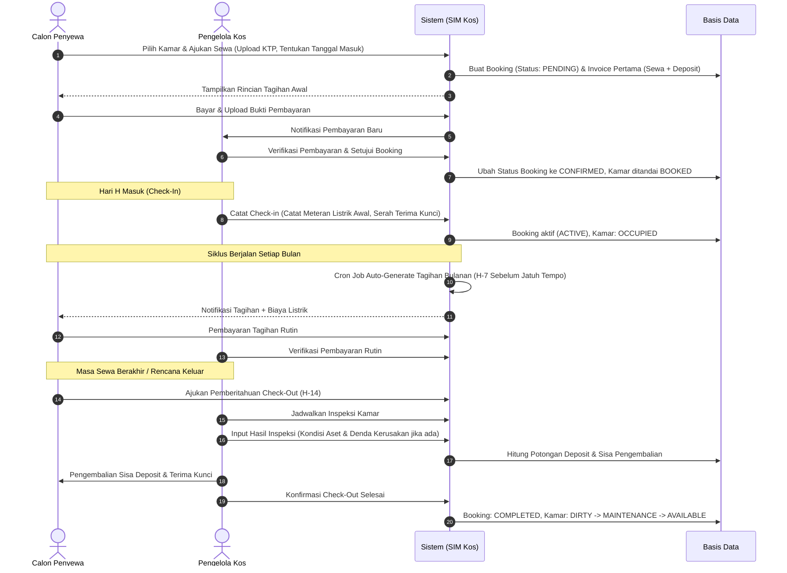
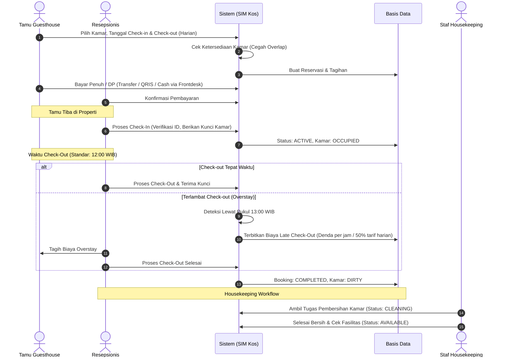
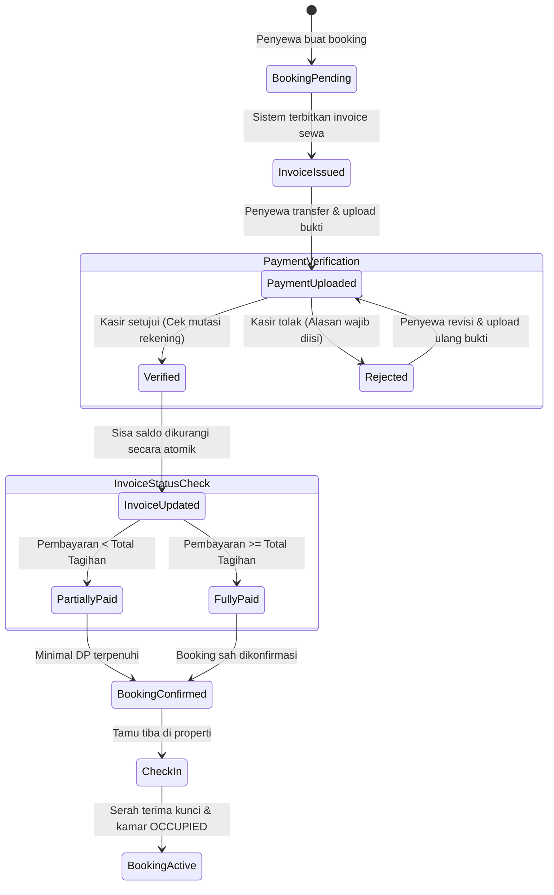
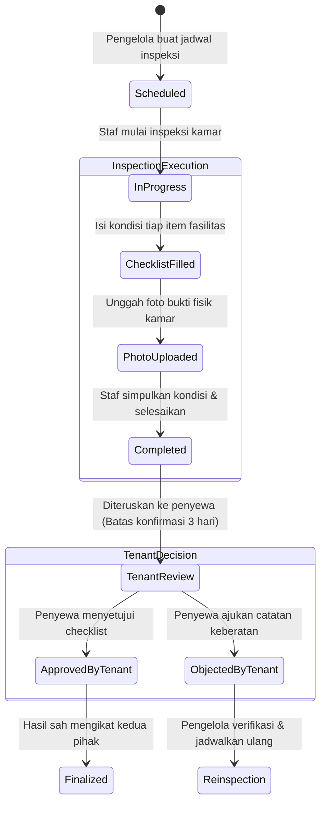
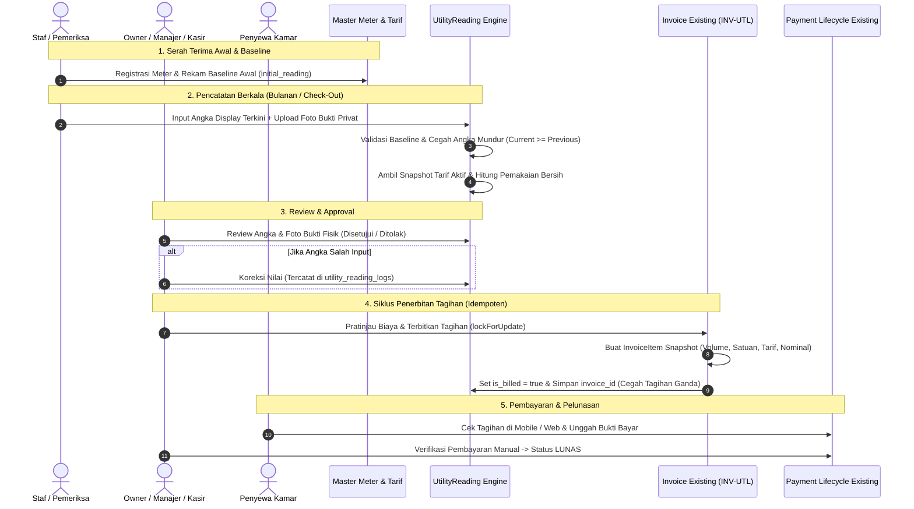

# Alur Bisnis & Siklus Penyewaan (Rental Workflow) - SIM Kos & Guesthouse

Dokumen ini mendeskripsikan secara komprehensif alur kerja operasional untuk dua model bisnis: **Kos (Jangka Panjang)** dan **Guesthouse (Jangka Pendek)**, termasuk penanganan deposit, meteran utilitas, denda keterlambatan, dan prosedur check-out.

---

## 1. Perbedaan Utama Model Operasional

| Aspek | Kos (Boarding House) | Guesthouse (Penginapan) |
| :--- | :--- | :--- |
| **Satuan Waktu** | Bulanan, 3 Bulanan, 6 Bulanan, Tahunan | Harian, Mingguan |
| **Uang Jaminan (Deposit)** | Wajib (Rp 500.000 - Rp 1.500.000) ditahan selama masa sewa | Opsional / Ringan (Rp 50.000 - Rp 200.000) |
| **Penagihan (Billing)** | Berulang (Recurring Invoice) setiap siklus sewa jatuh tempo | Sekali bayar di depan (Full Payment at Check-In) |
| **Utilitas Listrik/Air** | Meteran per kamar (dibayar sesuai pemakaian kwh bulanan) | Termasuk dalam harga per malam |
| **Status Kamar Pasca Check-Out** | Inspeksi inventaris detail, cat ulang jika perlu | Pembersihan cepat (Housekeeping turnover < 2 jam) |

---

## 2. Siklus Hidup Penyewaan Kos (Jangka Panjang)

### Aturan Khusus Kos:
1. **Invoice Terbit Otomatis**:
   Sistem menjalankan cron job setiap pukul 01:00 WIB untuk memeriksa kontrak aktif dan menerbitkan invoice tagihan sewa 7 hari sebelum jatuh tempo (`due_date`).
2. **Pencatatan Meteran Listrik**:
   - Tanggal pembacaan meteran listrik dicatat oleh pengelola antara tanggal 25-28 setiap bulan.
   - Formula:
     $$\text{Tagihan Listrik} = (\text{Meter Akhir} - \text{Meter Awal}) \times \text{Tarif per KWh}$$
   - Nilai tagihan ini otomatis digabungkan ke invoice sewa bulan bersangkutan.
3. **Pengembalian Deposit**:
   - Deposit tidak boleh digunakan untuk membayar sewa reguler tanpa persetujuan tertulis pengelola.
   - Saat check-out, deposit dikurangi biaya perbaikan inventaris rusak dan tunggakan listrik.
   - Sisa saldo ditransfer kembali ke rekening penyewa maksimal 3 hari kerja setelah check-out.

---

## 3. Siklus Hidup Reservasi Guesthouse (Jangka Pendek)

---

## 4. Alur Penanganan Komplain & Pemeliharaan (Maintenance)

1. **Pengajuan Tiket**:
   Penyewa membuat tiket via aplikasi mobile (Kategori: AC, Pipa/Air, Kelistrikan, Fasilitas Rusak, Kebersihan) dengan melampirkan foto dan tingkat urgensi (`low`, `medium`, `high`, `emergency`).
2. **Disposisi Staf**:
   Pengelola atau sistem menugaskan tiket kepada staf maintenance/housekeeping.
3. **Pengerjaan & Bukti**:
   Staf mengubah status menjadi `in_progress`, melakukan perbaikan fisik di kamar, dan mengunggah foto bukti perbaikan.
4. **Verifikasi & Penyelesaian**:
   Tiket ditandai `resolved`. Penyewa menerima notifikasi dan dapat memberikan konfirmasi serta ulasan kepuasan layanan.

---

## 5. Detail Alur Pembayaran Manual & Transisi Status Booking (Phase 2 Terimplementasi)

### Kebijakan Bisnis Pembayaran & Keuangan:
1. **Formula Saldo Tersisa**:
   $$\text{Sisa Saldo} = \text{Total Tagihan} - \sum(\text{Pembayaran Berstatus VERIFIED})$$
2. **Pencegahan Overpayment (Kelebihan Bayar)**:
   - Server menolak pengajuan nominal yang melebihi sisa saldo invoice (`amount > remaining_balance`).
   - Apabila penyewa tidak sengaja mentransfer lebih banyak di bank, kasir mencatat catatan rekonsiliasi dan sisa dana dialokasikan ke deposit atau dikembalikan manual via kas operasional.
3. **Pencegahan Double Processing (Race Condition)**:
   - Proses verifikasi menggunakan transaksi database atomik dengan `DB::raw` / pessimistic row locking `lockForUpdate()`.
   - Percobaan verifikasi kedua pada pembayaran yang sama akan ditolak dengan eksepsi `Payment status is not pending`.
4. **Larangan Verifikasi Sendiri**:
   - Penyewa tidak memiliki akses otorisasi untuk memverifikasi pembayarannya sendiri, bahkan jika memanipulasi request API. Petugas verifikasi wajib berwenang pada cabang properti tersebut.

---

## 5. Alur Kerja Inspeksi Kondisi Kamar & Serah Terima (Tahap 3)

### Aturan Bisnis & Kebijakan Inspeksi:
1. **Inspeksi Tidak Otomatis Mengaktifkan Booking**:
   - Keberadaan laporan inspeksi kamar (`check_in`) yang telah disetujui TIDAK otomatis mengubah status booking menjadi `active`.
   - Aktivasi masa sewa tetap tunduk pada aturan pembayaran Tahap 2: bukti pembayaran uang sewa dan deposit wajib berstatus `VERIFIED` oleh pengelola.
2. **Pemberian Checklist Awal Otomatis (Baseline)**:
   - Saat jadwal inspeksi dibuat, sistem otomatis menyalin daftar aset fisik kamar (`room_assets`) atau menggunakan 8 item standar jika aset belum didaftarkan.
   - Setiap butir checklist mencatat kondisi: `good`, `fair`, `poor`, `damaged`, atau `missing`.
3. **Komparasi Check-Out vs Check-In**:
   - Saat penyewa akan keluar (`check_out`), inspeksi akhir wajib dikaitkan dengan `baseline_inspection_id` (inspeksi check-in awal).
   - Sistem menghitung gradasi kerusakan secara otomatis: jika item mengalami degradasi (e.g. `good` menjadi `damaged` atau `missing`), sistem menghitung estimasi biaya kerusakan (`total_damage_cost`).
   - Biaya kerusakan ini dijadikan dasar perhitungan pemotongan uang deposit sewa penyewa sebelum pengembalian dana akhir.
4. **Batas Waktu dan Hak Keberatan Penyewa**:
   - Penyewa memiliki jendela konfirmasi (default: 3 hari sejak status `completed`).
   - Jika ada ketidaksesuaian fasilitas, penyewa mengajukan catatan keberatan melalui aplikasi mobile atau web dashboard. Staf/manajer kemudian memeriksa ulang dan merevisi butir terkait dengan riwayat audit trail yang tercatat utuh.

---

## 4. Alur Kerja Pengelolaan Utilitas & Integrasi Tagihan (Tahap 4)

### Penjelasan Tahapan Alur Kerja Utilitas:
1. **Penetapan Baseline Kamar Baru / Check-In**:
   - Saat kamar mulai disewakan, meteran fisik yang terpasang memiliki nilai awal (`initial_reading`).
   - Sistem menetapkan angka ini sebagai baseline pembacaan pertama sehingga penyewa tidak pernah ditagihkan angka bawaan pabrik atau sisa penghuni lama.
2. **Pencatatan Berkala & Validasi Server-Side**:
   - Staf memeriksa display fisik meter dan mengunggah foto display via mobile Flutter atau web dashboard.
   - Server memvalidasi bahwa nilai pembacaan tidak boleh lebih kecil dari pembacaan sebelumnya ($current \ge previous$).
   - Sistem secara otomatis mencari tarif aktif pada tanggal pembacaan tersebut (`effective_from` s/d `effective_to`) dan mengunci snapshot tarifnya.
3. **Pemeriksaan & Review Kasir/Manajer**:
   - Pembacaan masuk ke tab "Menunggu Review" di dashboard. Kasir/Manajer memeriksa kejelasan foto bukti display meteran.
   - Jika foto buram atau salah, Manajer menolak dengan alasan penolakan wajib (`rejection_reason`).
   - Jika terdapat salah ketik teknis, Manajer dapat melakukan koreksi berizin dengan audit trail lengkap (`utility_reading_logs`).
4. **Penerbitan Tagihan Idempoten ke Invoice Existing**:
   - Tagihan utilitas diterbitkan ke sistem invoice existing tanpa membuat modul pembayaran terpisah.
   - Tagihan mencatat line item `invoice_items` lengkap dengan kuantitas pemakaian, satuan (`kWh`/`m³`), tarif satuan, total nominal, dan metadata meter.
   - Row-level lock (`lockForUpdate`) menjamin invoice utilitas **tidak akan pernah terbit ganda** meskipun terjadi request bersamaan atau klik ganda.
5. **Pelunasan Menggunakan Sistem Pembayaran Existing**:
   - Pembayaran tagihan utilitas menggunakan alur kuitansi, pengajuan bukti transfer, dan verifikasi manual kasir (`Payment` lifecycle) yang sudah teruji sejak Tahap 2.

