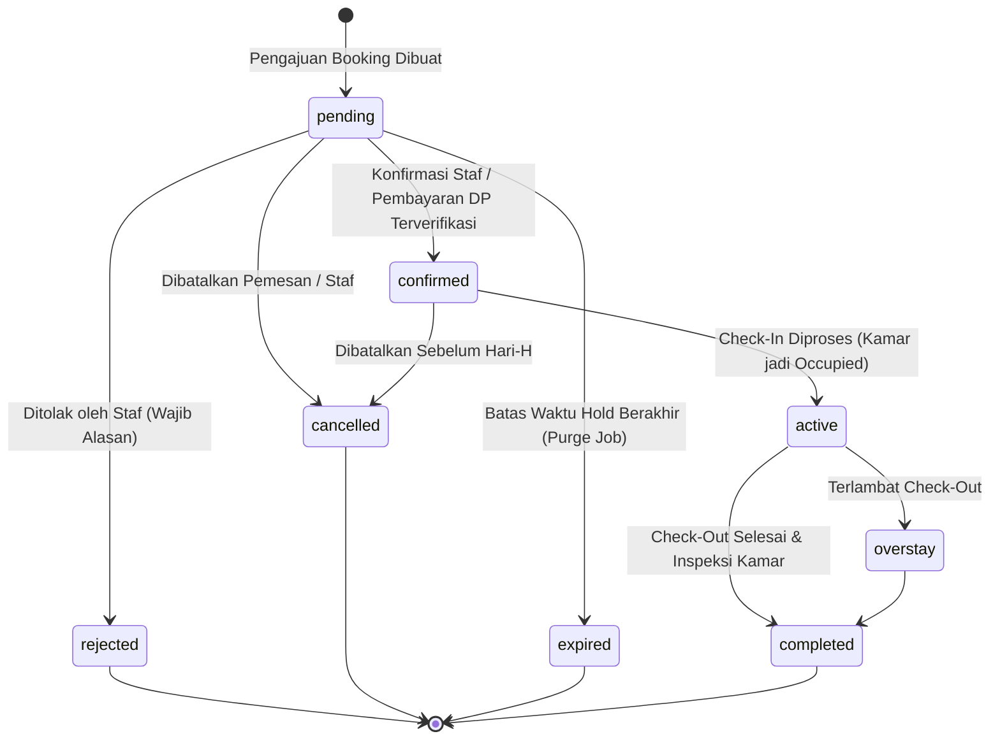

# Alur Kerja & Lifecycle Pemesanan Kamar (Booking Workflow)
## SIM Kos & Guesthouse (Laravel 13 + Bootstrap 5 + Flutter)

Dokumen ini menjelaskan alur bisnis pemesanan kamar (Booking) secara menyeluruh, mencakup siklus hidup status (lifecycle), pencegahan double booking, kebijakan uang muka per properti, serta integrasi check-in.

---

## 1. Tiga Jalur Pemesanan Terintegrasi

Sistem menyediakan 3 jalur pemesanan yang menggunakan **satu backend dan satu sumber data tunggal** (`BookingService`):
1. **Calon Penyewa Publik (Website Blade)**: Mengakses katalog, melihat ketersediaan real-time, mengisi form guest booking, menerima kode booking dan token akses pelacakan 60 karakter yang aman.
2. **Calon Penyewa / Guest (Flutter Mobile)**: Mengakses layar pemesanan melalui tombol "Pesan Kamar Sekarang" pada `PropertyDetailScreen`, melihat ringkasan harga kalkulasi server, dan submit booking tanpa dipaksa membuat akun staf.
3. **Admin / Resepsionis / Staf (Dashboard Internal)**: Membuat pemesanan internal atas nama penyewa terdaftar atau tamu baru melalui Right-Side Drawer `#createBookingDrawer` (`.drawer-lg`) dengan isolasi properti otomatis.

---

## 2. Diagram Siklus Hidup Status (Booking Lifecycle)



### Penjelasan Status:
| Status | Label UI | Deskripsi & Perilaku Sistem |
| :--- | :--- | :--- |
| `pending` | Menunggu Pembayaran / Review | Booking baru terbit. Menahan kamar sementara selama batas `payment_deadline_hours` properti. |
| `confirmed` | Terkonfirmasi (Siap Check-In) | Uang muka (DP) diverifikasi atau disetujui staf berwenang. Tanggal terkunci secara permanen. |
| `active` | Aktif (Sedang Ditempati) | Check-in telah diproses oleh petugas. Status kamar berubah dari `available` menjadi `occupied`. |
| `completed` | Selesai (Check-Out) | Masa sewa berakhir, inspeksi kamar selesai, dan deposit dikembalikan. Status kamar menuju `dirty`/`maintenance`. |
| `rejected` | Ditolak | Permohonan ditolak oleh manajemen dengan alasan tercatat. Tagihan belum terbayar dibatalkan. |
| `cancelled` | Dibatalkan | Pemesanan dibatalkan pemesan/staf dengan alasan. Kamar dilepaskan kembali. |
| `expired` | Kedaluwarsa | Batas waktu pembayaran/hold terlampaui. Kamar otomatis dilepaskan. |
| `overstay` | Overstay | Melewati batas tanggal keluar tanpa perpanjangan sewa atau check-out resmi. |

---

## 3. Pencegahan Double Booking & Logika Ketersediaan

### A. Formula Overlap Tanggal
Pengecekan overlap menggunakan formula standar interval tanggal tertutup-terbuka:
$$\text{Overlap} \iff (\text{start\_date} < \text{requested\_end\_date}) \land (\text{end\_date} > \text{requested\_start\_date})$$

### B. Serialisasi Permintaan Bersamaan (Pessimistic Locking)
Dua permintaan yang masuk secara bersamaan untuk kamar dan rentang tanggal yang sama ditangani menggunakan `DB::transaction()` dengan pessimistic locking:
```php
$room = Room::where('id', $payload['room_id'])->lockForUpdate()->firstOrFail();
$hasConflict = Booking::where('room_id', $room->id)
    ->where(function ($q) use ($now) {
        $q->whereIn('status', [BookingStatus::CONFIRMED->value, BookingStatus::ACTIVE->value])
          ->orWhere(function ($sub) use ($now) {
              $sub->where('status', BookingStatus::PENDING->value)
                  ->where(fn($exp) => $exp->whereNull('expires_at')->orWhere('expires_at', '>', $now));
          });
    })
    ->where(fn($q) => $q->where('start_date', '<', $endDate)->where('end_date', '>', $startDate))
    ->lockForUpdate()
    ->exists();
```
Jika konflik terdeteksi di dalam lock, request kedua langsung memicu exception `ValidationException` dengan pesan ramah pengguna.

---

## 4. Kebijakan Uang Muka (DP) & Pemisahan Deposit

### A. Aturan Per Properti
Uang muka tidak dipaksakan seragam di seluruh sistem, melainkan mengikuti kolom konfigurasi pada tabel `properties`:
- `dp_required` (boolean): Menentukan apakah properti mewajibkan DP.
- `dp_type` (`fixed` / `percentage`): Model perhitungan DP (persentase dari total biaya atau nominal tetap).
- `dp_amount` / `dp_percentage`: Besaran nominal atau persentase DP.
- `payment_deadline_hours`: Batas waktu pelunasan DP sebelum reservasi kedaluwarsa (default 24 jam).

### B. Pemisahan Tegas Uang Muka vs Uang Jaminan (Deposit)
1. **Biaya Sewa (Rent Rate)**: Pendapatan operasional kamar sesuai durasi sewa (harian/bulanan).
2. **Uang Muka (Down Payment)**: Pembayaran awal atas tagihan sewa.
3. **Uang Jaminan (Security Deposit)**: Dana jaminan kerusakan fasilitas.
   - Dicatat pada kolom `deposit_amount`.
   - **TIDAK** digabungkan sebagai pendapatan sewa.
   - Dikembalikan saat penyewa check-out setelah inspeksi kamar (`inspections`) tuntas.

---

## 5. Integrasi Check-In & Aktivasi Masa Sewa

Pada saat tamu tiba di lokasi kos/guesthouse:
1. Petugas membuka detail pemesanan di dashboard web atau aplikasi Flutter.
2. Memeriksa identitas tamu dan status booking (hanya status `confirmed` yang diizinkan).
3. Mengklik tombol **Proses Check-In**.
4. Sistem mengeksekusi transaksi atomik:
   - Status booking diubah menjadi `active`.
   - Waktu kedatangan dicatat pada `actual_check_in = now()`.
   - Petugas pencatat disimpan pada `checked_in_by = $user->id`.
   - Status kamar diubah menjadi `occupied` (`RoomStatus::OCCUPIED`).
   - Mencegah check-in ganda secara otomatis.
