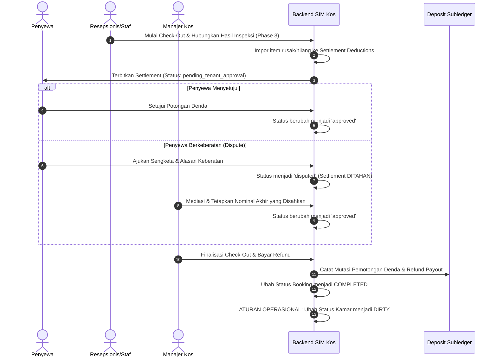

# DOKUMENTASI WORKFLOW PHASE 7: SECURITY DEPOSIT LEDGER, CHECK-OUT, INSPECTION SETTLEMENT & REFUND MANAGEMENT

Dokumen ini menjelaskan arsitektur, aturan bisnis, alur proses, kontrak API, skema basis data, dan hasil pengujian untuk modul **Phase 7: Security Deposit Ledger, Check-Out, Inspection Settlement & Refund Management** pada SIM Kos & Guesthouse.

---

## 1. TUJUAN & PEMISAHAN ENTITAS KEUANGAN

Phase 7 menerapkan pemisahan akuntansi dan operasional yang tegas antara:
1. **Pendapatan Sewa (Rental Revenue)**: Pendapatan operasional dari tarif sewa kamar kos/guesthouse yang diakui dari pembayaran invoice sewa terverifikasi.
2. **Uang Jaminan (Security Deposit)**: Dana titipan penyewa yang merupakan kewajiban pengembalian (*liability*), bukan hak pendapatan pemilik, sampai ada pemotongan ganti rugi kerusakan yang telah disetujui.
3. **Uang Muka Sewa (Down Payment / DP)**: Bagian dari pembayaran tarif sewa di muka yang mengurangi sisa tagihan sewa, bukan security deposit.
4. **Denda & Ganti Rugi Kerusakan (Approved Deductions)**: Potongan yang disahkan atas temuan inspeksi kamar (Phase 3) atau kehilangan fasilitas yang disetujui penyewa / diputuskan manajer.
5. **Pengembalian Dana (Refund Payout)**: Pengeluaran kas nyata (*cash-out*) kembali ke rekening atau tunai penyewa saat check-out difinalisasi.

---

## 2. SUBLEDGER UANG JAMINAN (SECURITY DEPOSIT SUBLEDGER)

### A. Definisi Status Deposit
- `pending`: Ledger dibuat otomatis saat pemesanan kamar disetujui, menunggu pembayaran uang jaminan terverifikasi.
- `held`: Uang jaminan telah diterima secara sah dan ditahan sebagai dana jaminan aktif masa sewa.
- `partially_refunded`: Sebagian uang jaminan telah dicairkan kembali ke penyewa.
- `refunded`: Seluruh sisa hak pengembalian uang jaminan telah dicairkan tuntas ke penyewa (saldo menjadi Rp 0).
- `settled`: Masa sewa check-out telah tuntas diselesaikan (seluruh deposit habis terpotong denda atau telah dikembalikan).
- `forfeited`: Uang jaminan hangus/disita sesuai ketentuan pelanggaran berat sewa.

### B. Tipe Mutasi Subledger (Immutable Ledger Entries)
Setiap mutasi dicatat secara *append-only* dengan kode unik (`MUT-YYYYMMDD-XXXXXX`), arah kas (`in`/`out`), saldo sebelum, saldo sesudah, dan pelaku audit:
- `deposit_received` (`in`): Penerimaan dana jaminan dari verifikasi pembayaran booking.
- `damage_deduction` (`out`): Pemotongan denda kerusakan fasilitas kamar hasil inspeksi check-out.
- `unpaid_bill_deduction` (`out`): Pemotongan tunggakan tagihan utilitas/sewa yang belum terbayar.
- `refund_payout` (`out`): Pembayaran pengembalian dana deposit ke rekening penyewa.
- `adjustment_credit` (`in`): Koreksi audit penambahan saldo oleh manajer berwenang dengan alasan tertulis.
- `adjustment_debit` (`out`): Koreksi audit pengurangan saldo oleh manajer berwenang dengan alasan tertulis.

### C. Formula Rekonsiliasi Saldo Deposit
$$\text{Saldo Akhir} = \text{Total Penerimaan} - \text{Total Potongan Denda} - \text{Total Pengembalian} \pm \text{Koreksi Audit}$$
- Saldo tidak boleh negatif ($\text{current\_balance} \ge 0$).
- Over-refund ditolak mutlak oleh sistem dengan exception tingkat domain.
- Menggunakan database locking (`lockForUpdate()`) untuk mencegah race condition pencatatan ganda.

---

## 3. ALUR CHECK-OUT & INSPECTION SETTLEMENT



### Aturan Operasional Kamar:
Pada saat check-out difinalisasi, status kamar **DIUBAH MENJADI `DIRTY` (Kotor / Perlu Housekeeping)**, bukan langsung `AVAILABLE`. Hal ini menjamin staf housekeeping melakukan pembersihan menyeluruh dan pengecekan ulang sebelum kamar dibuka untuk tamu baru.

---

## 4. ROLE & PERMISSION MATRIX

| Role | Lihat Saldo & Mutasi | Usulkan Settlement Check-Out | Respon Penyewa (Approve/Dispute) | Mediasi Sengketa (Resolve Dispute) | Finalisasi Refund & Payout | Koreksi Audit Manual |
| :--- | :---: | :---: | :---: | :---: | :---: | :---: |
| **Super Admin** | Semua Properti | Ya | Ya (Override) | Ya | Ya | Ya |
| **Owner** | Properti Sendiri | Ya | - | Ya | Ya | Ya |
| **Manager** | Properti Ditugaskan | Ya | - | Ya | Ya | Ya |
| **Receptionist / Staff** | Properti Ditugaskan | Ya | - | - | - | - |
| **Tenant** | Hanya Booking Milik Sendiri | - | Ya | - | - | - |

---

## 5. KONTRAK REST API

### 1. Daftar Subledger Deposit
- **Endpoint**: `GET /api/v1/deposits`
- **Headers**: `Authorization: Bearer <token>`, `Accept: application/json`
- **Query Params**: `status`, `property_id`, `search`, `page`, `per_page`
- **Response**:
```json
{
  "success": true,
  "message": "Daftar subledger deposit berhasil diambil.",
  "data": {
    "current_page": 1,
    "data": [
      {
        "id": 1,
        "deposit_code": "DEP-20261017-ABCDE",
        "booking_id": 10,
        "property_id": 1,
        "tenant_id": 5,
        "initial_deposit_amount": "1000000.00",
        "total_received": "1000000.00",
        "total_deductions": "100000.00",
        "total_refunded": "900000.00",
        "current_balance": "0.00",
        "status": "refunded",
        "property": {"name": "Kos Permata Hijau"},
        "booking": {"booking_code": "BKG-20261017-001"}
      }
    ]
  }
}
```

### 2. Inisiasi Check-Out Settlement
- **Endpoint**: `POST /api/v1/settlements`
- **Payload**:
```json
{
  "booking_id": 10,
  "inspection_id": 4,
  "check_out_date": "2026-10-17",
  "refund_destination": "BCA 123456789 a.n. Ahmad",
  "custom_deductions": [
    {
      "title": "Kunci Kamar Hilang",
      "amount": 50000
    }
  ]
}
```

### 3. Respon Persetujuan / Keberatan Penyewa
- **Endpoint**: `POST /api/v1/settlements/{id}/tenant-decision`
- **Payload Persetujuan**:
```json
{
  "decision": "approve"
}
```
- **Payload Keberatan (Dispute)**:
```json
{
  "decision": "dispute",
  "objection_notes": "Kunci kamar patah karena slot macet, bukan kelalaian penyewa."
}
```

### 4. Penyelesaian Sengketa Denda (Manager/Owner)
- **Endpoint**: `POST /api/v1/settlements/{id}/resolve`
- **Payload**:
```json
{
  "approved_amounts": {
    "12": 25000
  },
  "resolution_notes": "Disepakati biaya penggantian kunci dibagi 50:50 dengan pihak manajemen."
}
```

### 5. Finalisasi Check-Out & Refund
- **Endpoint**: `POST /api/v1/settlements/{id}/finalize` (atau `/finalize-refund`)
- **Payload**:
```json
{
  "refund_method": "bank_transfer",
  "refund_destination": "BCA 123456789 a.n. Ahmad",
  "refund_payment_reference": "TRF-BCA-998877"
}
```

---

## 6. STRUKTUR TABEL BASIS DATA

Tabel baru ditambahkan secara aditif melalui migrasi `2026_10_17_100000_create_phase7_deposit_and_settlement_tables.php`:
1. `deposit_ledgers`:
   - `id`, `deposit_code` (unique), `booking_id` (foreign, unique), `property_id` (foreign), `tenant_id` (foreign, nullable), `initial_deposit_amount` (decimal 12,2), `total_received`, `total_deductions`, `total_refunded`, `current_balance`, `status`, `notes`.
2. `deposit_mutations`:
   - `id`, `deposit_ledger_id` (foreign, cascade), `mutation_code` (unique), `transaction_type` (enum), `direction` (`in`/`out`), `amount`, `balance_before`, `balance_after`, `payment_method`, `payment_reference`, `invoice_id`, `payment_id`, `inspection_id`, `performed_by` (foreign), `notes`, `created_at`.
3. `check_out_settlements`:
   - `id`, `settlement_code` (unique), `booking_id` (foreign, unique), `deposit_ledger_id` (foreign), `inspection_id` (foreign, nullable), `property_id` (foreign), `tenant_id` (foreign, nullable), `check_out_date`, `status`, `deposit_balance_before`, `total_deductions`, `net_refund_amount`, `tenant_approved_at`, `tenant_objection_notes`, `resolved_by`, `resolved_at`, `resolution_notes`, `refund_method`, `refund_destination`, `refund_payment_reference`, `refunded_by`, `refunded_at`.
4. `settlement_deductions`:
   - `id`, `settlement_id` (foreign, cascade), `inspection_item_id` (foreign, nullable), `title`, `description`, `proposed_amount`, `approved_amount`, `is_approved`, `is_disputed`, `dispute_reason`.

---

## 7. HASIL PENGUJIAN AKTUAL

### A. Backend PHPUnit / Pest Feature Tests
- Perintah: `php artisan test`
- Hasil: **135 passed, 0 failed, 788 assertions** (Durasi: 2.39 detik).
- Mencakup seluruh 18 skenario Section L:
  1. Penghitungan saldo deposit dan pencatatan kas masuk.
  2. Pemisahan uang deposit dari pendapatan operasional sewa kos.
  3. Perbedaan uang muka (DP) sewa vs security deposit.
  4. Pengembalian deposit penuh dan sebagian.
  5. Penolakan mutlak atas over-refund.
  6. Penolakan finalisasi denda tanpa persetujuan sah.
  7. Penahanan settlement saat terjadi sengketa (dispute) oleh penyewa.
  8. Idempotensi verifikasi pembayaran mencegah pencatatan deposit ganda.
  9. Concurrency lock (`lockForUpdate()`) mencegah double payout.
  10. Integrasi temuan kerusakan inspeksi kamar Phase 3.
  11. Isolasi hak akses multi-tenant dan multi-properti.
  12. Pembatasan hak role untuk finalisasi refund dan penyelesaian sengketa.
  13. Akses bukti inspeksi privat terotorisasi.
  14. Konsistensi status kamar (`DIRTY`) dan booking (`COMPLETED`).
  15. Kompatibilitas migrasi aditif dan backward-compatibility.
  16. Rute web Blade dashboard, drawer, modal konfirmasi, dan validasi form.
  17. Kontrak REST API mobile.
  18. Regresi seluruh modul Phase 1–6 dan alur Booking End-to-End.

### B. Flutter Static Analysis & Widget Tests
- Perintah: `flutter analyze`
  - Hasil: **No issues found!** (0 error, 0 warning, 0 info).
- Perintah: `flutter test`
  - Hasil: **47 passed, 0 failed** (Durasi: 5.8 detik).
  - Menguji parsing model JSON, Riverpod providers, `DepositListScreen`, `DepositDetailScreen`, dan `SettlementDetailScreen`.
