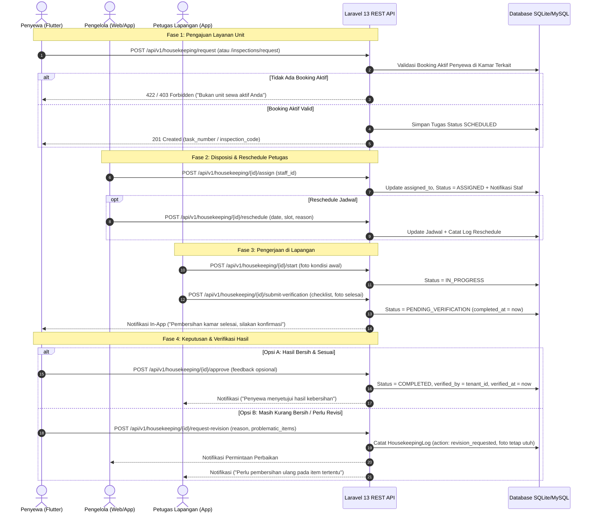

# Alur Kerja Layanan Kamar Terpadu (Inspeksi & Housekeeping)
## SIM Kos & Guesthouse — Unified Room Service Workflow

## 1. Arsitektur Alur Kerja & Status Lifecycle

Modul Layanan Kamar pada SIM Kos & Guesthouse mengintegrasikan dua fungsi operasional utama unit hunian:
1. **Pembersihan Kamar (Housekeeping)**: Pembersihan berkala, sanitasi kamar mandi, pembuangan sampah, dan penggantian linen.
2. **Inspeksi Kamar (Room Inspection)**: Pemeriksaan fisik fasilitas, kelayakan AC/furnitur, inventaris kunci, dan serah terima unit saat check-in/check-out.

Kedua alur menggunakan status lifecycle yang sinkron tanpa duplikasi skema tabel database:

### 1.1. Status Lifecycle Housekeeping (`HousekeepingStatus`)
```
[SCHEDULED] ──(Manager Assigns)──> [ASSIGNED] ──(Staff Starts)──> [IN_PROGRESS]
                                                                        │
                                                            (Staff Submits Verification)
                                                                        ▼
                                                             [PENDING_VERIFICATION]
                                                                    │       │
                                    (Tenant Confirms "Sesuai")──────┘       │ (Tenant Requests Revision)
                                    ▼                                       ▼
                              [COMPLETED]                    [PENDING_VERIFICATION]
                        (verified_by = tenant/manager)    (Log catatan item belum bersih)
```

### 1.2. Status Lifecycle Inspeksi Kamar (`InspectionStatus`)
```
[SCHEDULED] ──(Manager Assigns Inspector)──> [SCHEDULED / ASSIGNED]
                                                     │
                                             (Staff Executes)
                                                     ▼
                                              [IN_PROGRESS]
                                                     │
                                         (Staff Completes Checklist)
                                                     ▼
                                               [COMPLETED]
                                              /           \
                 (Tenant Confirms "Sesuai")  /             \  (Tenant Objects / Revisi)
                                            ▼               ▼
                                 [APPROVED_BY_TENANT]     [OBJECTED_BY_TENANT]
```

---

## 2. Diagram Urutan Alur Kerja (Sequence Diagram)



---

## 3. Spesifikasi Kontrak API Detail

### 3.1. Pengajuan Layanan oleh Penyewa
- `POST /api/v1/housekeeping/request`:
  - Payload: `{ "scheduled_date": "2026-10-19", "scheduled_slot": "Pagi (08:00 - 11:00)", "priority": "normal", "notes": "..." }`
  - Validasi: Otomatis mendeteksi kamar aktif penyewa via auth token. Menolak jika tidak ditemukan booking aktif berstatus `confirmed`, `active`, atau `checked_in`.

- `POST /api/v1/inspections/request`:
  - Payload: `{ "type": "periodic", "reason": "Pemeriksaan Rutin", "scheduled_date": "2026-10-20", "description": "..." }`
  - Validasi: Mengaitkan `property_id` dan `room_id` dari unit hunian penyewa aktif.

### 3.2. Penugasan & Reschedule oleh Manajer
- `POST /api/v1/housekeeping/{id}/assign`:
  - Payload: `{ "assigned_to": 3 }` (atau `{ "staff_id": 3 }`)
  - Otorisasi: `manager`, `owner`, `super_admin`.
- `POST /api/v1/inspections/{id}/assign`:
  - Payload: `{ "inspector_id": 3 }`
  - Otorisasi: `manager`, `owner`, `super_admin`.
- `POST /api/v1/housekeeping/{id}/reschedule`:
  - Payload: `{ "scheduled_date": "2026-10-21", "scheduled_slot": "Siang (13:00 - 15:00)", "reason": "Penyesuaian shift staf" }`
- `POST /api/v1/inspections/{id}/reschedule`:
  - Payload: `{ "scheduled_date": "2026-10-22", "reschedule_reason": "Penyewa sedang dinas luar kota" }`

### 3.3. Keputusan Penyewa atas Hasil Pekerjaan
- `POST /api/v1/housekeeping/{id}/approve`:
  - Tombol UI: `Sesuai — Konfirmasi Selesai`
  - Payload: `{ "feedback": "Kamar sudah rapi dan wangi" }`
  - Response: `{ "success": true, "message": "Hasil pembersihan kamar berhasil dikonfirmasi selesai." }`
- `POST /api/v1/housekeeping/{id}/request-revision`:
  - Tombol UI: `Belum Sesuai — Minta Perbaikan`
  - Payload: `{ "reason": "Kaca jendela dan area bawah kasur masih berdebu", "problematic_items": ["Lap kaca", "Sapu lantai"] }`
  - Response: `{ "success": true, "message": "Permintaan perbaikan kebersihan telah dikirim ke pengelola dan staf." }`
  - Proteksi: Foto kondisi selesai staf tidak dihapus/dihilangkan, riwayat perbaikan tersimpan di log audit.
